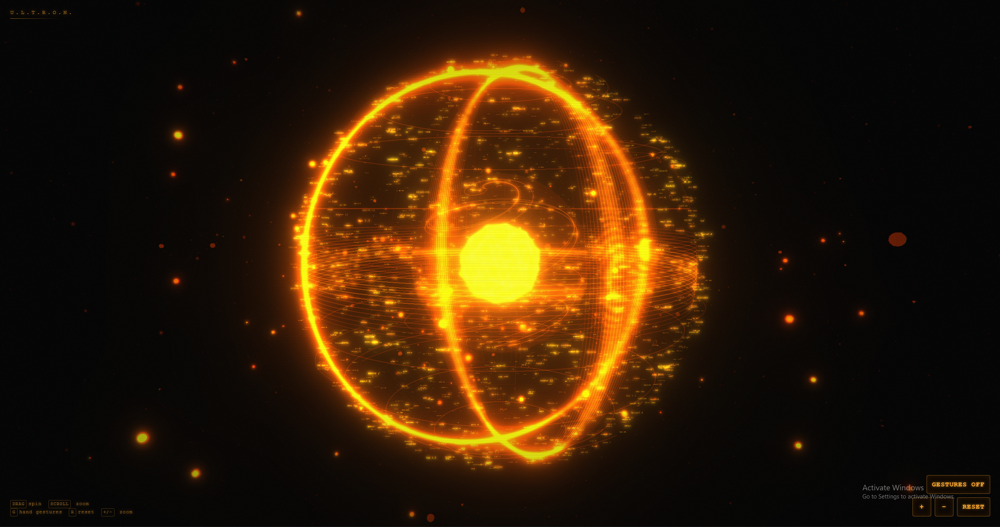

# D-ASK: Offline-First, Native Windows Desktop AI Assistant



**D-ASK** is an offline-first, native Windows 11 AI desktop assistant. It combines an Iron Man–inspired holographic 3D orb HUD, local language model reasoning, local speech/vision, and verified desktop automation. 

Unlike traditional cloud-tethered or script-based automation, D-ASK operates with a strict **Separation of Powers**:  
**The AI model only proposes; a separate, hardened .NET daemon owns authorization, cryptographic approvals, and execution.**

> 🛡️ **Zero Cloud Dependency:** 100% functional with Wi-Fi switched off. No telemetry, no cloud inference, no data leaves your machine.  
> ⚡ **No Electron:** Built entirely with a native stack (Rust + WebView2 + wgpu, .NET 8 Daemon, and an unprivileged Node.js child host).

---

## 🏛️ Architecture & Separation of Powers

D-ASK separates cognitive reasoning from operating system privileges:

```mermaid
flowchart TD
    subgraph Presentation["Presentation & Native Control (Rust / wgpu / WebView2)"]
        OVERLAY["Transparent Win32 Overlay<br/>(WS_EX_LAYERED + DirectComposition)"]
        ORB["3D Holographic Orb<br/>(wgpu / WGSL Shader)"]
        HOTKEY["Isolated Panic Hotkey Thread<br/>(RegisterHotKey Ctrl+Shift+F12)"]
        LATCH["Native Stop Latch<br/>(Monotonic Epoch Counter)"]
        HUD_UI["React 19 HUD<br/>(ApprovalSurface / AgentStatus / ManagePanel)"]
        
        OVERLAY --> HUD_UI
        OVERLAY --> ORB
        HOTKEY --> LATCH
    end

    subgraph SecurityDaemon["Security & Operating System Core (C# .NET 8)"]
        IPC["Hardened Named Pipe Server<br/>(\\\\.\\pipe\\dask-ipc)"]
        POLICY["Action Policy Engine<br/>(Canonical SHA-256 Hashing)"]
        EXEC["Action Execution Engine<br/>(Drain Integrity & LRU Stop Cache)"]
        UIA["Observation & UI Automation<br/>(COM IUIAutomation + GDI BitBlt)"]
        JOB["Agent Supervisor<br/>(Windows Job Object)"]
        
        IPC --> EXEC
        IPC --> POLICY
        EXEC --> UIA
        JOB --> POLICY
    end

    subgraph AgentHost["Reasoning Engine (TypeScript / Node.js)"]
        HOST["Stdio Agent Host<br/>(agent/host/stdioHost.ts)"]
        RUNTIME["Agent Runtime 2.0<br/>(Planner, Verifier & Grounding)"]
        LOCAL_LLM["Local llama-server<br/>(GGUF: Qwen 0.5B / 1.5B / 3B)"]
        RAG["Local Knowledge Base & Memory<br/>(SQLite FTS5 + bge-small-en-v1.5)"]
        
        HOST --> RUNTIME
        RUNTIME --> LOCAL_LLM
        RUNTIME --> RAG
    end

    %% Communication Links
    LATCH ==>|"Priority IPC Channel (Cap 16)<br/>EmergencyStop / Resume"| IPC
    HUD_UI <-->|"Action Approvals / State Sync"| IPC
    JOB <==|"Stdio JSON-RPC 2.0 (v2)<br/>Action Requests (Guarded)"| HOST
```

### Key Architectural Guarantees
1. **Unprivileged Agent Host:** The TypeScript runtime runs as a restricted child process inside a Windows Job Object. It has zero native handles to Windows APIs, input simulation, or files outside configured roots.
2. **Cryptographic Action Approval:** Mutating or privileged desktop actions require the daemon to generate a canonical SHA-256 parameter digest. The action is held in a gate until the user reviews and clicks **Approve** in the floating HUD modal.
3. **Hardware-Isolated Emergency Stop:** A global panic hotkey (`Ctrl + Shift + F12`) runs on a dedicated Win32 OS thread with its own message pump. It trips an atomic, fail-closed native latch that immediately cancels in-flight tasks (<5 ms) and blocks further execution across IPC disconnects and reconnections.
4. **Independent Verification:** Tasks are reported `COMPLETED` only if independently verified by re-reading the OS/filesystem state; otherwise they are reported as `UNVERIFIED`, `PARTIAL`, `REFUSED`, or `FAILED`.

---

## ✨ Features

### 🔮 1. Holographic HUD & 3D Jarvis Orb
- **Hardware-Accelerated 3D Visualizer:** Real-time 3D rendering using `wgpu` and custom WGSL shaders (`orb.wgsl`) on DirectX 12/Vulkan, plus a Three.js web view.
- **Dynamic States:** Animates through *Idle*, *Listening*, *Thinking*, *Speaking*, *Executing*, and *Emergency Stopped*.
- **Touchless Hand Gestures:** Optional webcam tracking powered by MediaPipe. Pinch with one hand to rotate the orb; pinch with both hands and expand/contract to zoom with hysteresis filtering.
- **Transparent Desktop Overlay:** Borderless, click-through Win32 window (`WS_EX_LAYERED` with DirectComposition) embedding WebView2 without clipping or background artifacts.

### 🛡️ 2. Hardware-Isolated Emergency Stop
- **Instant Kill Hotkey (`Ctrl + Shift + F12`):** Works even when the UI thread, WebView2, or .NET daemon is frozen.
- **Fail-Closed Monotonic Latch:** Latch state cannot be bypassed or cleared by restarting or reconnecting the IPC pipe.
- **Cryptographic Session Binding:** Resume signals require verified session tokens and matching epoch generations; duplicate, stale, or replayed signals are rejected.
- **Biased Priority IPC:** Stop commands bypass normal message queues through a dedicated 16-capacity priority channel.

### 👁️ 3. Desktop Observation & Vision
- **Windows UI Automation:** Deep accessibility tree queries via COM `IUIAutomation` (control types, bounding boxes, element names, automation IDs) without screen scraping.
- **Fast Desktop Capture:** Zero-copy GDI `BitBlt` capture into shared memory with multi-monitor DPI coordinate normalization.
- **Local Windows OCR (`dask-ocr`):** On-device text recognition using native `Windows.Media.Ocr` (~339 ms latency, zero cloud API calls).

### 🖱️ 4. Guarded Desktop Automation
- **Element-Bound Input:** Clicks and keystrokes are bound to verified UI Automation elements rather than guessed screen coordinates.
- **Physical Override Detection:** Any physical human mouse movement or keyboard press immediately halts ongoing synthetic automation.
- **Strict Application Whitelist:** In production, application launching is restricted to pre-verified applications (e.g., Notepad, Calculator) with strict window lifecycle tracking.

### 📁 5. File Operations & Smart Notes
- **Semantic File Management:** Search, inspect, read, and summarize local text, code, and documents.
- **Safe Directory Organization:** Plan and execute folder cleanup operations with persistent write-ahead undo journals.
- **Verified Note Creation:** Create structured notes with disk-write confirmation and audit journaling.

### ⏱️ 6. Workflows & Background Scheduler
- **Multi-Step Routines:** Define 1–8 step sequential desktop workflows.
- **Deterministic Natural Language Intent:** Strict parser and keyword grounding ensure time words and names come directly from the user's instructions.
- **Background Scheduler:** Autonomous 20-second tick scheduler running inside the daemon with restart persistence (missed executions are never blindly run).

### 🧠 7. Local Knowledge Base (RAG) & Semantic Memory
- **Local SQLite Store:** Sub-millisecond preference queries and persistent user memory.
- **Hybrid Local RAG:** FTS5 BM25 full-text search combined with int8 cosine similarity via `bge-small-en-v1.5` embeddings on the local `llama-server`.
- **Research Mode:** Generate literature reviews and technical gap analyses strictly from local documents with verified source citations.

### 🎙️ 8. Local Voice Interaction
- **Speech-to-Text (STT):** Local Whisper (`whisper.cpp`, ~1.9s latency on CPU) or Windows SAPI.
- **Text-to-Speech (TTS):** Windows SAPI or local Piper voice engine.

---

## 📋 System Requirements

| Component | Minimum Requirement | Recommended |
| :--- | :--- | :--- |
| **Operating System** | Windows 11 x64 (Build 22000+) | Windows 11 x64 Latest |
| **Processor** | Intel Core i5 (12th/13th Gen) or AMD Ryzen 5 | Intel Core i7 / AMD Ryzen 7 |
| **Memory (RAM)** | 16 GB (requires ~3 GB free for model) | 16 GB+ |
| **Graphics** | Intel Iris Xe / AMD Radeon Integrated | NVIDIA GTX/RTX or Intel Arc |
| **Runtimes** | .NET 8.0 SDK, Rust MSVC toolchain, Node.js 24+ | WebView2 (preinstalled on Win 11) |

---

## 🚀 Quick Start: Building From Source

### 1. Clone & Install Dependencies

```powershell
git clone https://github.com/your-repo/D-ASK.git
cd D-ASK

# Install Node.js dependencies
npm install
```

### 2. Fetch Pinned Local Models & Inference Tools

```powershell
# Downloads pinned local GGUF models (hash-verified)
node scripts/inference/fetch-model.mjs

# Downloads pinned local llama-server executable
node scripts/inference/fetch-llama-server.mjs

# (Optional) Fetch whisper.cpp for enhanced offline speech recognition
node scripts/inference/fetch-whisper.mjs
```

### 3. Build Components

```powershell
# 1. Build Agent Host
npm run build:agent-host

# 2. Build Next.js HUD Frontend
npm run build

# 3. Build .NET 8 Daemon
dotnet build src/DAsk.Daemon -c Debug

# 4. Build Rust Native HUD Overlay
cargo build --manifest-path src/hud-native/Cargo.toml
```

### 4. Run the Development Stack

```powershell
# Starts the .NET Daemon and Rust HUD together with log output in OutDir
powershell -File scripts\hud\start-stack.ps1 -OutDir scratch\dev-run

# To stop all running components:
powershell -File scripts\hud\stop-stack.ps1 -OutDir scratch\dev-run
```

---

## 📦 Native Package (Distributable Installer)

D-ASK packages into a standalone, non-administrator per-user Windows distribution:

```powershell
# Build the native distribution package
node scripts/package/build-package.mjs

# Verify package manifest and file hashes
node scripts/package/build-package.mjs --verify --out dist\desktop\<package-folder>

# Run installer (creates Start Menu shortcuts in user profile)
powershell -File dist\desktop\<package-folder>\Install-D-ASK.ps1
```

The daemon verifies every file, the Node.js runtime, and the plugin sandbox against `package-manifest.json` on each start. Any tampered or altered file immediately halts startup.

---

## ⚙️ Configuration & Data Paths

- **User Data Directory:** `%LOCALAPPDATA%\D-ASK\`
  - `workflows.json` — Saved routines and scheduler state
  - `plugins-approved.json` — User-authorized plugin registry
  - `memory.db` & `knowledge.db` — Local SQLite databases
  - `hud.log` — Execution trace logs
- **Feature Flags:**  
  All capabilities default to `OFF` for safety. Enable features in `%LOCALAPPDATA%\D-ASK\features.cmd` or via environment variables (`DASK_AgentHost__<Feature>=true`).
- **Memory CLI:**  
  Manage your local memory without invoking the LLM:
  ```powershell
  npx tsx agent/runtime/memory/memoryCli.ts list
  npx tsx agent/runtime/memory/memoryCli.ts search "project deadline"
  npx tsx agent/runtime/memory/memoryCli.ts forget <id>
  npx tsx agent/runtime/memory/memoryCli.ts clear --yes
  ```

---

## 🧪 Testing & Verification Suites

D-ASK includes an exhaustive multi-tiered test suite:

```powershell
# 1. Typecheck TypeScript
npx tsc --noEmit -p tsconfig.json

# 2. Run Agent Runtime Unit Tests
npx tsx tests/agent-runtime/agent-runtime.test.ts
npx tsx tests/agent-runtime/desktop.test.ts
npx tsx tests/agent-runtime/knowledge.test.ts

# 3. Run .NET Daemon Security & Policy Tests
dotnet test tests/DAsk.Daemon.Tests

# 4. Run Rust HUD Native Tests
cargo test --manifest-path src/hud-native/Cargo.toml
```

### Acceptance Harnesses (Real-HUD Automation)
Automated PowerShell harnesses in `scripts/hud/` launch the real stack, simulate user requests, verify approval cards, and assert state changes:
- `approval-live-7b3.ps1` — Core P0 verification
- `approval-live-timed.ps1` — Scheduler & persistent background firing
- `approval-live-memory.ps1` — Local memory storage and semantic recall
- `run-offline-acceptance-7b3.ps1` — Wi-Fi-off acceptance harness monitoring process tree sockets for zero non-loopback connections

---

## 🎮 Interactive Controls Reference

### Keyboard Controls
| Key Shortcut | Action |
| :--- | :--- |
| `Ctrl + Shift + F12` | **EMERGENCY STOP (Global Panic Hotkey)** — Instantly kills in-flight actions & latches safety state |
| `G` | Toggle webcam hand gesture tracking |
| `R` | Reset 3D Orb camera view |
| `+` / `-` | Zoom 3D Orb in / out |

### Webcam Hand Gestures (MediaPipe)
Press `G` to enable the camera feed:
| Gesture | Action |
| :--- | :--- |
| **Single-Hand Pinch** (Thumb + Index) | Rotate and spin the holographic orb |
| **Two-Hand Pinch & Spread** | Zoom in / Zoom out |

---

## 📄 License & Attribution

- **License:** MIT License. See [LICENSE](LICENSE) for details.
- **Attribution:** The 3D holographic orb concept and gesture framework were inspired by the open-source [ULTRON Orb UI](https://github.com/sagartamang/ultron-orb-ui) by Sagar Tamang. The daemon, security architecture, offline agent runtime, Rust native overlay, and emergency stop systems are developed for D-ASK.
