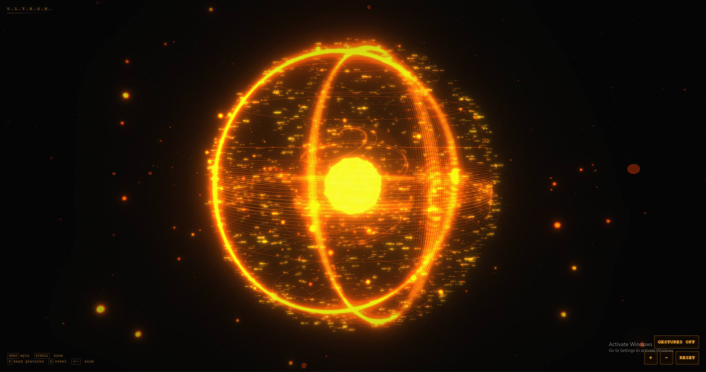
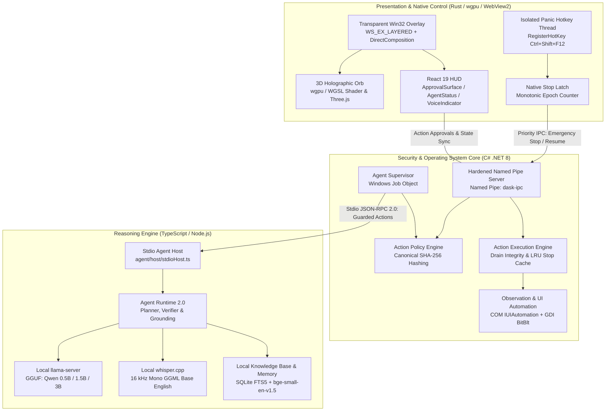

# D-ASK: Offline-First, Native Windows Desktop AI Assistant



[](https://microsoft.com/windows)
[](docs/product-completion/FINAL-ACCEPTANCE-AUDIT-2026-11-16.md)
[](docs/audits/DASK_INDEPENDENT_QA_REPORT.md)
[](LICENSE)

**D-ASK** is an offline-first, native Windows 11 AI desktop assistant. It combines an Iron Man–inspired holographic 3D orb HUD, local speech recognition, local language model reasoning, and verified desktop automation. 

Unlike traditional cloud-tethered or script-based automation, D-ASK operates with a strict **Separation of Powers**:  
**The AI model only proposes; a separate, hardened .NET daemon owns authorization, cryptographic approvals, and operating system execution.**

> 🛡️ **Zero Cloud Dependency:** 100% functional with Wi-Fi switched off. No telemetry, no cloud inference, no data leaves your machine.  
> ⚡ **No Electron:** Built entirely with a native stack (Rust + WebView2 + wgpu, .NET 8 Daemon, and an unprivileged Node.js child host).  
> 🎯 **Audited & Accepted:** Independently audited on build `D-ASK-20261116T223649` with physical offline voice confirmed by human testing.

---

## 🏛️ Architecture & Separation of Powers

D-ASK separates cognitive reasoning from operating system privileges:



### Key Architectural Guarantees
1. **Unprivileged Agent Host:** The TypeScript runtime runs as a restricted child process inside a Windows Job Object. It has zero native handles to Windows APIs, input simulation, or files outside configured roots.
2. **Cryptographic Action Approval:** Mutating or privileged desktop actions require the daemon to generate a canonical SHA-256 parameter digest. The action is held behind a security gate until the user reviews and clicks **Approve** in the floating HUD modal.
3. **Hardware-Isolated Emergency Stop:** A global panic hotkey (`Ctrl + Shift + F12`) runs on a dedicated Win32 OS thread with its own message pump. It trips an atomic, fail-closed native latch that immediately cancels in-flight tasks (<3 ms) and blocks further execution across IPC disconnects and reconnections.
4. **Anti-Clickjacking Protection:** Approval cards enforce an unconditional 250 ms delay (`ARM_DELAY_MS`) before clicks are registered, preventing rapid background clicks from inadvertently approving actions.
5. **Independent Verification:** Tasks are reported `COMPLETED` only if independently verified by re-reading the OS/filesystem state; otherwise they are reported as `UNVERIFIED`, `PARTIAL`, `REFUSED`, or `FAILED`.

---

## ✨ Features

### 🎙️ 1. Offline Physical Voice Interaction
- **Synchronous Web Audio Lifecycle:** Bypasses browser autoplay restrictions inside user click and hotkey gestures; eliminates frozen audio clocks.
- **Band-Limited Speech VAD:** Real-time 4th-order biquad bandpass filter (300–4,500 Hz) with dynamic ambient noise floor tracking; immune to 50/60 Hz hum, air conditioning rumble, and chassis clicks.
- **500 ms Pre-Roll Buffer:** Circular audio ring buffer guarantees zero clipping of leading wake-words (*"D-ASK"*, *"Open"*).
- **Digital Peak Normalization & Quality Gate:** Automatically normalizes low-gain laptop microphone signals (-50 dBFS) to -1 dBFS with soft-limiting for transients; rejects silence and background dither.
- **Local Whisper Speech-to-Text (`whisper.cpp`):** Local CPU inference utilizing quantized `ggml-base.en-q5_1.bin` (hash-verified via Windows CNG); delivers ~1.8–3.8 s latency with **0 network calls**.

### 🔮 2. Holographic HUD & 3D Jarvis Orb
- **Hardware-Accelerated 3D Visualizer:** Real-time 3D rendering using `wgpu` and custom WGSL shaders on DirectX 12/Vulkan, with Three.js web view fallback.
- **Dynamic States:** Animates dynamically through *Idle*, *Listening*, *Recording*, *Transcribing*, *Executing*, and *Emergency Stopped*.
- **Touchless Hand Gestures:** Optional webcam tracking powered by MediaPipe. Single-hand pinch to rotate; two-hand pinch-and-spread to zoom with hysteresis filtering.
- **Transparent Desktop Overlay:** Borderless, click-through Win32 window (`WS_EX_LAYERED` with DirectComposition) embedding WebView2 without clipping or background artifacts.

### 🛡️ 3. Hardware-Isolated Emergency Stop
- **Instant Kill Hotkey (`Ctrl + Shift + F12`):** Works globally even when the UI thread, WebView2, or .NET daemon is frozen.
- **Fail-Closed Monotonic Latch:** Latch state cannot be bypassed or cleared by restarting or reconnecting the IPC pipe.
- **Cryptographic Session Binding:** Resume signals require verified session tokens and matching epoch generations; duplicate, stale, or replayed signals are rejected.
- **Biased Priority IPC:** Stop commands bypass normal message queues through a dedicated 16-capacity priority channel.

### 🖱️ 4. Guarded Desktop Automation
- **Target Window Identity Validation:** Input simulation checks foreground window title, process ID, and window handle before injecting keystrokes; aborts immediately if focus shifts.
- **Microsoft Word Automation:** Launches Word, binds to the `Document` control via UI Automation `TextPattern`, enters text safely, and reads back content independently without disk writes.
- **Notepad & Calculator:** Native launch and text injection with deterministic parameter pinning.
- **Chrome Browser Integration:** Launches Chrome and searches the web without requiring an extension; supports existing window title transition tracking when Chrome is already running.
- **Physical Override Detection:** Any physical human mouse movement or keyboard press immediately halts ongoing synthetic automation.

### 📁 5. Intelligent File Operations & Smart Notes
- **Deep Search & Find Text:** Search files by glob pattern across approved roots; grep text inside documents with exact line number references and independent disk re-verification.
- **Document Summarization:** Extractive, deterministic outlines for Markdown, text, and PDF files; summarizes CSV/TSV table structures and JSON schemas.
- **Safe Directory Organization:** Plan and execute folder cleanup operations by **type** (Documents, Spreadsheets, Images, Code, etc.), by **month**, or by **extension** with persistent undo journals (`files.undo_organize`).
- **Verified Note Creation:** Create structured notes with non-overwrite safety and byte-for-byte read-back confirmation.
- **Automatic Secret Redaction:** API keys, AWS tokens, and private keys found inside documents are automatically masked.

### 🧠 6. Local Knowledge Base (RAG) & Semantic Memory
- **Local SQLite Store:** Sub-millisecond preference queries and persistent user memory.
- **Hybrid Local RAG:** FTS5 BM25 full-text search combined with int8 cosine similarity via `bge-small-en-v1.5` embeddings on the local `llama-server`.
- **Offline Document Q&A:** Grounded answers extracted directly from local files with verified source citations.

### ⏱️ 7. Workflows & Background Scheduler
- **Multi-Step Routines:** Define 1–8 step sequential desktop workflows.
- **Deterministic Natural Language Intent:** Strict parser and keyword grounding ensure time words and names come directly from the user's instructions.
- **Background Scheduler:** Autonomous 20-second tick scheduler running inside the daemon with restart persistence (missed executions are never blindly run).

---

## 📋 System Requirements

| Component | Minimum Requirement | Recommended |
| :--- | :--- | :--- |
| **Operating System** | Windows 11 x64 (Build 22000+) | Windows 11 x64 Latest (Build 26100+) |
| **Processor** | Intel Core i5 (12th/13th Gen) or AMD Ryzen 5 | Intel Core i7 / AMD Ryzen 7 (8+ cores) |
| **Memory (RAM)** | 16 GB (requires ~3 GB free for local model) | 16 GB - 32 GB |
| **Audio Input** | Standard built-in microphone array or USB mic | Built-in Intel Smart Sound or directional mic |
| **Graphics** | Intel Iris Xe / AMD Radeon Integrated | Intel Iris Xe, NVIDIA RTX, or Intel Arc |
| **Runtimes** | .NET 8.0 SDK, Rust MSVC toolchain, Node.js 24+ | WebView2 (preinstalled on Windows 11) |

---

## 🚀 Quick Start: Building From Source

### 1. Clone & Install Dependencies

```powershell
git clone https://github.com/jyotydivya/D-ASK.git
cd D-ASK

# Install Node.js dependencies
npm install
```

### 2. Fetch Pinned Local Models & Inference Tools

```powershell
# Downloads pinned local GGUF models (hash-verified via Windows CNG)
node scripts/inference/fetch-model.mjs

# Downloads pinned local llama-server executable
node scripts/inference/fetch-llama-server.mjs

# Fetches pinned whisper.cpp binary and GGML base English model
node scripts/inference/fetch-whisper.mjs
```

### 3. Build Components

```powershell
# 1. Typecheck TypeScript
npx tsc --noEmit -p tsconfig.json

# 2. Build Agent Host
npm run build:agent-host

# 3. Build Next.js HUD Frontend
npm run build

# 4. Build .NET 8 Daemon
dotnet build src/DAsk.Daemon -c Release

# 5. Build Rust Native HUD Overlay
cargo build --release --manifest-path src/hud-native/Cargo.toml
```

### 4. Run the Development Stack

```powershell
# Starts the .NET Daemon and Rust HUD together with log output in OutDir
powershell -ExecutionPolicy Bypass -File scripts\hud\start-stack.ps1 -OutDir scratch\dev-run

# To stop all running components:
powershell -ExecutionPolicy Bypass -File scripts\hud\stop-stack.ps1 -OutDir scratch\dev-run
```

---

## 📦 Native Package (Distributable Installer)

D-ASK packages into a standalone, non-administrator per-user Windows distribution:

```powershell
# Build the native distribution package
node scripts/package/build-package.mjs

# Verify package manifest and file hashes
node scripts/package/build-package.mjs --verify --out dist\desktop\<package-folder>

# Run installer (installs to %LOCALAPPDATA%\Programs\D-ASK with Start Menu shortcuts)
powershell -ExecutionPolicy Bypass -File dist\desktop\<package-folder>\Install-D-ASK.ps1
```

The daemon verifies every file, the Node.js runtime, and the plugin sandbox against `package-manifest.json` on each start. Any tampered or altered file immediately halts startup.

---

## ⚙️ Configuration & Data Paths

- **Application Directory:** `%LOCALAPPDATA%\Programs\D-ASK\`
- **User Data Directory:** `%LOCALAPPDATA%\D-ASK\`
  - `workflows.json` — Saved routines and scheduler state
  - `memory.db` & `knowledge.db` — Local SQLite databases
  - `hud.log` & `daemon.log` — Execution trace logs
- **Feature Configuration:**  
  Configure feature flags in `%LOCALAPPDATA%\D-ASK\features.cmd` or via environment variables (`DASK_AgentHost__<Feature>=true`).
- **Memory CLI:**  
  Manage local memory without invoking the LLM:
  ```powershell
  npx tsx agent/runtime/memory/memoryCli.ts list
  npx tsx agent/runtime/memory/memoryCli.ts search "project deadline"
  npx tsx agent/runtime/memory/memoryCli.ts forget <id>
  npx tsx agent/runtime/memory/memoryCli.ts clear --yes
  ```

---

## 🧪 Testing & Independent QA Audit

D-ASK is verified by a multi-tiered test matrix of over 1,150 automated assertions and direct human acceptance:

```powershell
# 1. Voice Capture, VAD & Normalization Suite (41 checks)
npx tsx tests/hud-agent/voice-capture.test.ts

# 2. Desktop Automation & Guarded Input Suite (257 checks)
npx tsx tests/agent-runtime/desktop.test.ts

# 3. Security & Loopback Isolation Suite (220 checks)
npx tsx tests/security/api-auth.test.ts

# 4. Filesystem, Search, and Organization Suites
npx tsx tests/agent-runtime/filesystem.test.ts
npx tsx tests/agent-runtime/file-organize.test.ts
npx tsx tests/agent-runtime/notes.test.ts

# 5. .NET Daemon Security, UI Automation, & Observation (242 tests)
dotnet test tests/DAsk.Daemon.Tests/DAsk.Daemon.Tests.csproj

# 6. Rust Native HUD, Protocol, & Emergency Stop (74 tests)
cargo test --manifest-path src/hud-native/Cargo.toml
```

### Comprehensive QA Reports
- [FINAL-ACCEPTANCE-AUDIT-2026-11-16.md](docs/product-completion/FINAL-ACCEPTANCE-AUDIT-2026-11-16.md) — Authoritative final acceptance report.
- [DASK_INDEPENDENT_QA_REPORT.md](docs/audits/DASK_INDEPENDENT_QA_REPORT.md) — Independent QA audit & defect verification report.
- [DASK_FUNCTIONAL_COVERAGE_MATRIX.md](docs/audits/DASK_FUNCTIONAL_COVERAGE_MATRIX.md) — 8-domain multi-layer test coverage matrix.
- [DASK_REPRODUCIBLE_BUG_REPORT.md](docs/audits/DASK_REPRODUCIBLE_BUG_REPORT.md) — Tracking and resolution verification of defects BUG-001 through BUG-008.
- [DASK_REGRESSION_RESULTS.md](docs/audits/DASK_REGRESSION_RESULTS.md) — Cross-build regression comparison across builds `151233`, `210103`, and `223649`.
- [DASK_MANUAL_TEST_REQUIREMENTS.md](docs/audits/DASK_MANUAL_TEST_REQUIREMENTS.md) — Human-in-the-loop and physical hardware test protocols.

---

## 🎮 Interactive Controls Reference

### Keyboard Controls
| Key Shortcut | Action |
| :--- | :--- |
| `Ctrl + Shift + F12` | **EMERGENCY STOP (Global Panic Hotkey)** — Instantly kills in-flight actions & latches safety state (<3 ms) |
| `Ctrl + Shift + Space` | **Toggle HUD Mode** — Switch between Interactive Mode (takes focus) and Ambient Mode (click-through) |
| `V` | **Arm Voice Input** — Open local microphone session with real-time level indicator |
| `G` | **Toggle Hand Gestures** — Enable / disable webcam hand tracking |
| `R` | **Reset Camera** — Re-center 3D Orb camera view |
| `+` / `-` | **Zoom Camera** — Zoom 3D Orb in / out |

### Webcam Hand Gestures (MediaPipe)
Press `G` to enable the camera feed:
| Gesture | Action |
| :--- | :--- |
| **Single-Hand Pinch** (Thumb + Index) | Rotate and spin the holographic orb |
| **Two-Hand Pinch & Spread** | Zoom in / Zoom out |

---

## 📄 License & Attribution

- **License:** MIT License. See [LICENSE](LICENSE) for details.
- **Attribution:** The 3D holographic orb concept and gesture framework were inspired by the open-source [ULTRON Orb UI](https://github.com/sagartamang/ultron-orb-ui) by Sagar Tamang. The security daemon, native overlay, speech processing pipeline, offline agent runtime, and emergency stop systems are developed specifically for D-ASK.
