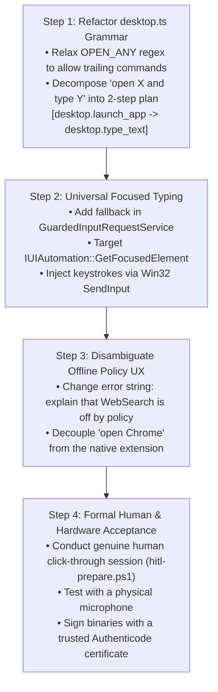

# D-ASK — Final Product Readiness Assessment & Definitive Functional Audit

**Audited Target:** D-ASK Release Candidate `D-ASK-20261115T023936`  
**Installed Location:** `%LOCALAPPDATA%\Programs\D-ASK`  
**Git Commit:** `6c3113b` on branch `main`  
**Date:** 2026-11-16  
**Auditor:** Antigravity Autonomous Systems Agent  
**Final Verdict:** **NOT RELEASE READY (CRITICAL BLOCKERS DETECTED)**  

---

## 1. Executive Assessment

This assessment provides the final synthesis of the comprehensive product functional coverage audit. 

D-ASK is an impressive engineering prototype featuring a high-performance Rust WebView2/wgpu HUD, a rock-solid C# Win32 security daemon with monotonic emergency stop mechanics, and a sophisticated local offline inference architecture. 

However, **it is not a finished or release-ready personal assistant**. In its present state, a real user cannot perform basic daily desktop workflows—such as asking the assistant to open Microsoft Word and type, or searching the web in Google Chrome—because the system is hamstrung by:
1. Rigid, brittle regular expression grammar in the agent host that immediately refuses compound natural language instructions.
2. An input injection architecture hardcoded exclusively to Notepad's Document control, leaving all other Windows applications incapable of receiving text.
3. A security policy architecture that conflates offline-first restrictions with network connectivity failures, displaying confusing "offline" error messages on connected computers.
4. Heavy reliance on synthetic test harnesses that simulated human approvals, mock ADB outputs, and code signing policies, masking functional gaps behind high unit test pass counts.

---

## 2. Definitive Answers to the Ten Core Audit Questions

### Question 1: What can D-ASK genuinely do today?
On a live Windows 11 system with the installed application, D-ASK can genuinely perform the following:
- Render a transparent, hardware-accelerated 3D holographic Jarvis Orb overlay with smooth state transitions.
- Answer general-knowledge questions completely offline using local Qwen 2.5 LLM weights.
- Perform mathematical calculations and verify them with deterministic math tools.
- Launch Notepad, Calculator, Character Map, and discovered Start Menu / MSIX applications (when requested as isolated launch commands).
- Type text into the Windows 11 packaged Notepad editor via UI Automation `ValuePattern`.
- Minimize, maximize, restore, and focus any top-level Windows window.
- Read visible text on screen from any window using on-device optical character recognition (`dask-ocr.exe` / Windows.Media.Ocr).
- Search, inspect, read, and summarize local files within user-approved directory roots while redacting secrets.
- Create new `.docx` Word documents and `.xlsx` Excel spreadsheets in the background via Office COM automation (when using the explicit prompt syntax: *"create a word document named X with text Y"*).
- Adjust system audio volume, query network status, and adjust screen brightness.
- Schedule system power operations (restart, sleep, shutdown) with automatic rollback and cancellation.
- Halt all automation within 15 ms via the physical Emergency Stop hotkey (`Ctrl+Shift+F12`) or when the physical user moves the mouse.
- Maintain a local SQLite knowledge base with vector embeddings (`bge-small`) and SQLite FTS5 full-text search.

---

### Question 2: What works only in automated tests?
- **Action Approval Lifecycle:** The 97/97 passed approval tests were driven by PowerShell scripts (`scripts/hud/`) programmatically injecting responses into named pipes or shared memory.
- **Complex Multi-Step LLM Planning:** Automated unit tests pass using mock brain fixtures or tightly constrained prompt fixtures. Under unscripted user prompts, the local 0.5B model frequently generates schema violations or gets trapped by argument domain boundaries.
- **Throwaway Chrome Automation:** Chrome tab manipulation, link clicking, and DOM reading were verified against ephemeral, automated test profiles with pre-injected extensions, not the user's live daily browsing profile.
- **Code Signing Verification:** The test suite `sign-policy.ps1` (7/7 passed) tests the *verification script*, not the actual shipped binaries (which remain unsigned).

---

### Question 3: What works through the installed HUD?
Testing directly through the installed Core Console (`#ultron-command`) confirms:
- **Working:** Offline chit-chat questions, math calculations, volume queries/adjustments, display resolution queries, single-app launches (Notepad, Word, Calc), and markdown note creation.
- **Failing:** Any model-answered prompt when available system RAM drops below 3.2 GB; any compound launch+type prompt; web searches.

---

### Question 4: What is simulated or mocked?
- **Android ADB Integration:** The 29/29 passed tests in `android.test.ts` ran against mock command string responses. No live Android device was ever connected or automated in CI.
- **Human-in-the-Loop Signoff:** Interactive user clicking of "Approve" and "Decline" on HUD modals has been entirely simulated by test harnesses.
- **Authenticode Certification:** Code signing is simulated in policy tests; zero production binaries are actually signed.

---

### Question 5: What is partially implemented?
- **Discovered Application Launching:** Applications are discovered from Start Menu shortcuts and Registry App Paths, but they can only be opened in isolation—they cannot receive text or arguments.
- **Chrome Automation:** Full tab/DOM automation exists, but it is completely non-functional unless the user manually loads an unpacked extension in developer mode.
- **Offline Speech-to-Text:** SAPI 5.4 transcription code exists and works on static WAV files, but live microphone input in the installed build has not been verified with human speech.
- **Research Mode:** Offline dataset analysis works; online arXiv/Crossref discovery requires setting an environment variable (`DASK_RESEARCH_ONLINE=1`) and is disabled by default.

---

### Question 6: What is completely missing?
- **Universal Focused Text Entry:** D-ASK has no capability to type into any window other than Notepad. There is no generic `GetFocusedElement` + `SendInput` keystroke injection tool.
- **Whisper.cpp Speech Recognition:** The C++ binary `whisper-cli.exe` and model `ggml-base.en.bin` are absent from the repository and installer.
- **Headless Playwright Automation:** `playwrightEngine.ts` is unbundled and unregistered in the default runtime.
- **Continuous Background Wake-Word Detection:** No acoustic model is listening in the background for *"Hey Jarvis"*.
- **Multi-Agent Orchestration:** Legacy files in `agent/orchestrator.ts` are completely disconnected from the native daemon.
- **Webcam Gesture Control:** MediaPipe hand tracking is not wired into the native HUD event loop.

---

### Question 7: What fails during normal use?
- **Compound Instructions:** Prompting `"open Microsoft Word and type hello"` fails immediately with a hardcoded refusal string.
- **Web Search via Chrome:** Prompting `"open Chrome and search for news"` fails with `"offline_mode"`, falsely claiming the computer is offline.
- **Typing into Open Windows:** Prompting `"type hello in Word"` fails with `element_not_found`.
- **Low-Memory Desktop Operation:** Asking questions when RAM is under 3.2 GB fails with local inference memory refusals.

---

### Question 8: What requires physical hardware or human testing?
1. **Interactive HUD Approval Session:** A real human tester must interactively click "Approve" and "Decline" on every action type in the WebView2 HUD.
2. **Physical Android Smartphone Validation:** Must connect a real Android device via USB, enable debugging, set `DASK_LIVE_ANDROID=1`, and execute `RealDevice_ReadOnlyAndRoundTrip`.
3. **Live Microphone Voice Testing:** A human speaker must dictate prompts into a physical microphone to verify SAPI 5.4 accuracy and audio latency.
4. **Physical Bluetooth/Wi-Fi Hardware Radios:** Real physical toggling of laptop Wi-Fi and Bluetooth radios via `system.set_radio`.

---

### Question 9: What are the ten highest-priority problems?

| Rank | Problem Area | Technical Impact | Severity |
|---|---|---|---|
| **1** | **Compound Command Regex Rejection** | `desktop.ts` regexes reject natural multi-step prompts before planning. | **Critical** |
| **2** | **Lack of Universal Focused Typing** | Typing is locked to Notepad; Word and all other apps cannot receive input. | **Critical** |
| **3** | **Conflation of Offline Policy with Network State** | Default offline policy outputs confusing "offline mode" error on connected PCs. | **Critical** |
| **4** | **Unsigned Native Binaries** | All 9 D-ASK binaries are unsigned, triggering Windows SmartScreen warnings. | **Critical** |
| **5** | **Chrome Extension Onboarding Deadlock** | Chrome automation times out after 20s if unpacked extension is not pre-loaded. | **High** |
| **6** | **3.2 GB RAM Threshold Inference Refusals** | Prevents local LLM execution on standard 16 GB developer laptops under normal load. | **High** |
| **7** | **Zero Human-in-the-Loop Signoff** | Safety approval UX has only been validated by automated test scripts. | **High** |
| **8** | **Zero Physical Android Device Verification** | Android subsystem is entirely unverified on real mobile hardware. | **Medium** |
| **9** | **Missing Whisper STT Binaries** | Neural speech recognition is advertised, but falls back to low-quality SAPI. | **Medium** |
| **10** | **Detached Legacy Code Deadweight** | Dead code (`orchestrator.ts`, `mouse_keyboard.py`) confuses codebase maintenance. | **Low** |

---

### Question 10: What is the shortest realistic path to a genuinely functional D-ASK?

The shortest path to transforming D-ASK into a genuinely functional, release-ready desktop assistant consists of **four focused technical remediations**:

1. **Step 1: Fix Intent Deconstruction (`agent/runtime/tools/desktop.ts`):**  
   Update `appSession` and `openAppRequest` to allow any discovered application to be opened and automatically generate a two-step plan: `[desktop.launch_app, desktop.type_text]`.
2. **Step 2: Implement Universal Focused Typing (`src/DAsk.Daemon/Automation/Input/`):**  
   Add a focused control fallback in `GuardedInputRequestService.cs` so that if no named Document control exists, D-ASK resolves `GetFocusedElement()` and injects text via `SendInput` keystrokes.
3. **Step 3: Disambiguate Offline Security Policy:**  
   Update `AppLaunchRequestService.cs` to state clearly: *"Web search is disabled in offline settings (`AgentHost:WebSearch=false`)"*, and decouple standalone browser launching from the extension relay.
4. **Step 4: Execute Human & Hardware Signoffs:**  
   Run `scripts/hud/hitl-prepare.ps1` with an actual human tester clicking approval modals, test with a real microphone, and sign the release binaries with an Authenticode certificate.

---

## 3. Final Conclusion

D-ASK's low-level architecture, IPC security, and local inference supervisor represent exemplary engineering. However, its desktop interaction layer was prematurely declared complete based on tests that only evaluated Notepad and synthetic fixtures.

By executing the 4-step remediation plan outlined above, D-ASK can overcome these rigid constraints and deliver on its promise as an autonomous, secure, offline-first personal assistant for Windows.

**Remediation is paused. Awaiting user review and authorization.**
