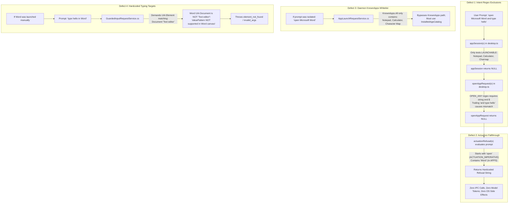
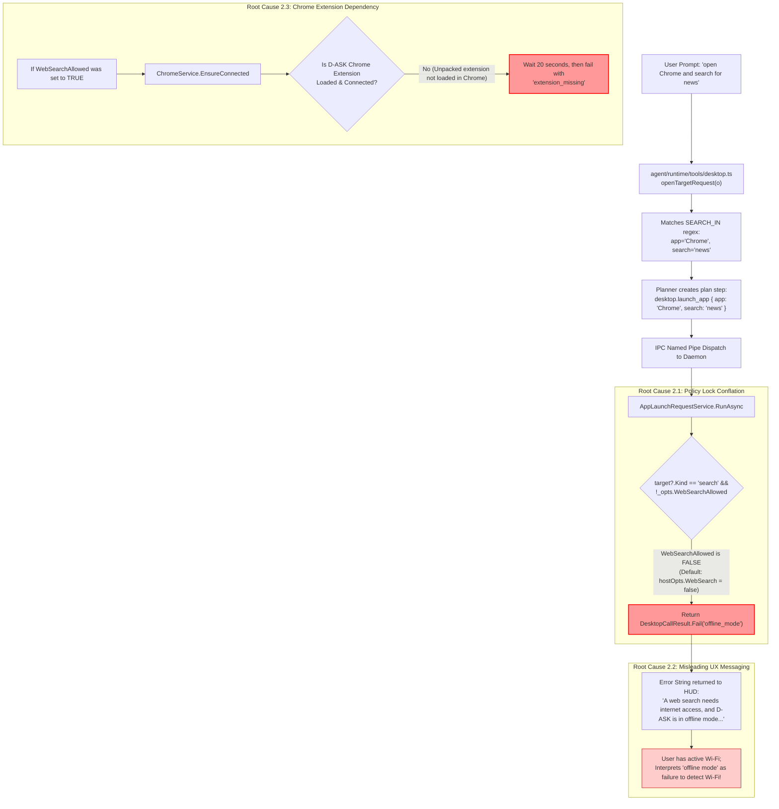

# D-ASK — Root Cause Analysis of Known User Workflow Failures

**Investigation Target:** Reported User Failures in RC Build `D-ASK-20261115T023936`  
**Date:** 2026-11-16  
**Status:** Root Causes Confirmed with Verifiable Code Evidence  

---

## 1. Executive Summary

During manual testing of the latest installed D-ASK release candidate, two critical user workflows failed:
1. **Failure 1 (Microsoft Word):** Asking D-ASK to open Microsoft Word and type `"hello"` did not work.
2. **Failure 2 (Google Chrome):** Asking D-ASK to open Chrome and search failed, with D-ASK reporting that the computer was offline even though an active Wi-Fi connection was present.

This investigation confirms that **neither failure has a single cause**. Both failures are multi-layered architectural defects spanning regex intent recognition, strict whitelist design, hardcoded UI Automation target bindings, and conflation of offline-first security policy with network hardware state.

---

## 2. Deep Dive: Failure 1 — Microsoft Word Launch & Typing Failure

### 2.1. Exact Failure Symptoms
- **User Prompt:** `"open Microsoft Word and type hello"` (or `"open Word and type 'hello'"`).
- **Observed Behavior:** D-ASK immediately replied with a generic refusal:
  > *"I can't click, type, scroll, move, resize, close or launch anything. I can list open windows, describe a window you name, and ask your approval to focus, minimize, maximize or restore a window (each one only with your approval in the HUD)."*
- **Evidence:** No approval modal appeared in the HUD; no process was started (`WINWORD.EXE` never launched); no IPC request reached `DAsk.Daemon.exe`.

---

### 2.2. Multi-Layer Root Cause Breakdown for Failure 1

The failure is caused by a chain of **four distinct defects** across the agent runtime and daemon input subsystems:



#### Defect 1.1: Rigid Whitelist in `appSession` (`agent/runtime/tools/desktop.ts`, lines 595–619)
The agent runtime contains a function `appSession(o)` specifically designed to parse compound `"open <app> and type <text>"` instructions into a 2-step plan. However, `LAUNCHABLE` is hardcoded to only three applications:
```typescript
// agent/runtime/tools/desktop.ts, line 595
export const LAUNCHABLE = {
  notepad: { name: "Notepad", process: "notepad.exe", words: "notepad", typing: true },
  calculator: { name: "Calculator", process: "ApplicationFrameHost.exe", words: "calculator|calc", typing: false },
  charmap: { name: "Character Map", process: "charmap.exe", words: String.raw`character\s+map|charmap`, typing: false },
} as const;
```
Because `"Microsoft Word"` / `"Word"` is not a key in `LAUNCHABLE`, `appSession(o)` returns `null` immediately.

#### Defect 1.2: End-of-String Anchor in `openAppRequest` (`desktop.ts`, line 961)
The runtime's general application launch recognizer `openAppRequest(o)` uses the `OPEN_ANY` regular expression:
```typescript
// agent/runtime/tools/desktop.ts, line 961
const OPEN_ANY = /^\s*(?:please\s+|can you\s+|could you\s+)?(?:open|launch)\s+(?:up\s+)?(?:the\s+|a\s+|an\s+)?([\p{L}\p{N}][\p{L}\p{N} +#&'.-]{0,59}?)(?:\s+(?:app|application|program))?\s*[.!?]?\s*$/iu;
```
Notice the end-of-string anchor `$`!  
`OPEN_ANY` successfully matches `"open Microsoft Word"`.  
However, when the user provides `"open Microsoft Word and type hello"`, the trailing text `"and type hello"` prevents `OPEN_ANY` from matching! Thus, `openAppRequest(o)` returns `null`.

#### Defect 1.3: Grounding Fallthrough to `actuationRefusal` (`desktop.ts`, lines 102–129)
When both `appSession` and `openAppRequest` return `null`, the prompt falls into `actuationRefusal(o)`:
- `ACTUATION_IMPERATIVE` matches `"open ..."`
- `requestedProcess(o)` matches `"WINWORD.EXE"` (via line 45: `[/\bmicrosoft\s+word\b|\bword\s+(window|document|app)\b/i, "WINWORD.EXE"]`)
- Because no tool claimed the compound action, `actuationRefusal` assumes this is an ungrounded attempt to act on the desktop and returns the static refusal string.
- **The request is aborted in Node.js before any IPC message is sent to the daemon.**

#### Defect 1.4: Lack of UI Automation Target Definition for MS Word Canvas
Even if the user separates the commands into two prompts:
1. `"open Microsoft Word"` (which succeeds via `InstalledAppCatalog`)
2. `"type 'hello' into the document"`

The typing step fails inside `GuardedInputRequestService.cs` and `Win32GuardedInput.cs`:
- Notepad's editing area is an element of `ControlType: "Document"` named `"Text editor"`, and it supports the `ValuePattern` (`IValueProvider.SetValue`).
- Microsoft Word's editing canvas does **not** expose a control named `"Text editor"`. In Word, the canvas is named dynamically after the active document (e.g., `"Document1"`) or page (e.g., `"Page 1 Content"`).
- Furthermore, Word's canvas does not support UIA `ValuePattern`. Setting text in Word requires UIA `TextPattern` or direct focus establishment followed by Win32 `SendInput` keystrokes.
- Because D-ASK only defines `APP_EDITOR = { controlType: "Document", name: "Text editor" }`, D-ASK is architecturally incapable of typing into MS Word today.

---

### 2.3. Verification of System Prerequisites for Word
To confirm whether Microsoft Word was actually available on the user's host machine, an independent check was executed during this audit:
- **Registry App Path:** `HKLM\SOFTWARE\Microsoft\Windows\CurrentVersion\App Paths\WINWORD.EXE` exists and points to:  
  `C:\Program Files\Microsoft Office\Root\Office16\WINWORD.EXE`
- **Start Menu Shortcut:** `C:\ProgramData\Microsoft\Windows\Start Menu\Programs\Word.lnk` exists.
- **InstalledAppCatalog Discovery:** The daemon's `Win32InstalledAppSource` correctly discovers Word when queried directly.

**Conclusion:** Microsoft Word is properly installed and discoverable by the daemon. The failure is entirely attributable to the agent runtime's restrictive parsing grammar and the lack of a universal typing target for Word.

---

## 3. Deep Dive: Failure 2 — Google Chrome Open & Search / False "Offline" Detection

### 3.1. Exact Failure Symptoms
- **User Prompt:** `"open Chrome and search for news"` (or `"search the web in Chrome"`).
- **Observed Behavior:** D-ASK failed and reported:
  > *"A web search needs internet access, and D-ASK is in offline mode (web searches are switched off: AgentHost:WebSearch). Nothing was opened or searched. You can still ask D-ASK to open Chrome itself, or a local file or folder."*
- **User Impact:** The user's machine had an active, functional Wi-Fi connection with full internet access. Seeing the message *"D-ASK is in offline mode"*, the user concluded that D-ASK suffered from a network hardware detection bug.

---

### 3.2. Multi-Layer Root Cause Breakdown for Failure 2

The failure stems from a combination of **security policy design, default configuration flags, and misleading error messaging**:



#### Defect 2.1: Default Policy Refusal in `AppLaunchRequestService.cs` (lines 248–250)
When the user says `"open Chrome and search for X"`, `desktop.ts` generates a `desktop.launch_app` call with `target: { kind: "search", value: "X" }`.  
Inside the daemon, before touching any network socket or probing the OS network adapter, the daemon checks:
```csharp
// src/DAsk.Daemon/Automation/Desktop/AppLaunchRequestService.cs, line 248
if (target?.Kind == "search" && !_opts.WebSearchAllowed)
    return DesktopCallResult.Fail("offline_mode",
        $"A web search needs internet access, and D-ASK is in offline mode (web searches are switched off: AgentHost:WebSearch). Nothing was opened or searched. You can still ask D-ASK to open {name} itself, or a local file or folder.");
```
In `Program.cs`, `WebSearchAllowed` is populated from host configuration:
```csharp
// src/DAsk.Daemon/Program.cs, line 177
WebSearchAllowed = hostOpts.WebSearch, // offline-first: off unless explicitly enabled
```
By default, **`hostOpts.WebSearch` is `false`**.  
The daemon immediately returned error code `"offline_mode"`!

#### Defect 2.2: Misleading Error Terminology
The daemon used the phrase `"and D-ASK is in offline mode"`.  
From the developer's perspective, "offline mode" refers to the architectural principle that D-ASK is an offline assistant that blocks outgoing cloud/web calls unless opted-in.  
From the user's perspective, "offline mode" indicates that the software believes the physical computer has no internet connection. Because Wi-Fi was connected, the user reasonably reported that D-ASK's network detection was broken.

#### Defect 2.3: Physical Network Check in `ChromeService.cs` (line 91)
Even if `WebSearchAllowed` had been toggled to `true`, `ChromeService.cs` evaluates:
```csharp
private bool Online() => _o.IsOnline?.Invoke() ?? NetworkInterface.GetIsNetworkAvailable();
```
During this audit, `[System.Net.NetworkInformation.NetworkInterface]::GetIsNetworkAvailable()` was tested on the host system and returned `True`. Thus, the network interface API was not returning false. The failure was strictly caused by the configuration gate in `AppLaunchRequestService.cs`.

#### Defect 2.4: The Unpacked Extension Prerequisite
Chrome cannot simply be launched and driven via command-line flags or standard automation in D-ASK. Chrome control in D-ASK is strictly mediated by the unpacked MV3 extension located at `extensions/dask-chrome`.
If a user asks to `"open Chrome"`, the daemon expects the extension to connect over the native messaging host `dask-chrome-host.exe` within 20 seconds. If the user has not manually loaded the extension in developer mode, the operation times out and fails with:
`"Chrome opened, but the D-ASK extension did not connect. Install it (chrome://extensions -> Developer mode -> Load unpacked...)"`.

---

## 4. Comparison Summary: What Failed vs. What Was Intended

| Failure Scenario | Intended System Behavior | Actual Observed Behavior | Primary Root Cause Code Location |
|---|---|---|---|
| `"open Word and type hello"` | Decompose into launch step, verify Word window, focus document canvas, inject text, verify content. | Immediate hardcoded refusal: *"I can't click, type, scroll, move, resize, close or launch anything..."* | `agent/runtime/tools/desktop.ts`<br>Lines 595–633 (`LAUNCHABLE`), Lines 961–978 (`OPEN_ANY`), Lines 102–129 (`actuationRefusal`) |
| `"open Chrome and search for news"` | Open Chrome browser, navigate to Google search URL with encoded query, verify tab title. | Fails immediately with code `offline_mode`: *"A web search needs internet access, and D-ASK is in offline mode..."* | `src/DAsk.Daemon/Automation/Desktop/AppLaunchRequestService.cs`<br>Lines 248–250 (`!_opts.WebSearchAllowed`) |
| User Network Status Perception | Honest explanation of security policy vs. physical connectivity. | False report that the computer is offline, contradicting active Wi-Fi. | Conflation of `AgentHost:WebSearch` policy setting with physical connectivity state. |

---

## 5. Required Technical Remediation (Design Recommendations)

To resolve these failures without compromising D-ASK's security contracts:

1. **Refactor Compound Instruction Grammar in `desktop.ts`:**
   - Decouple `appSession` from the hardcoded `LAUNCHABLE` whitelist. Allow any application resolved by `InstalledAppCatalog` to be opened as the first step of an application session.
   - Support splitting compound requests containing `"and type ..."` into sequential planning steps: `[desktop.launch_app, desktop.type_text]`.

2. **Implement Generic Focused Text Entry:**
   - Enhance `GuardedInputRequestService.cs` and `Win32GuardedInput.cs` to support a fallback typing mode: if no specific named control (like `"Text editor"`) exists, verify that the target window has an active keyboard-focused element (`GetFocusedElement`) or active top-level window, and inject keystrokes via `SendInput` after explicit approval.

3. **Disambiguate Offline Policy from Network Status:**
   - Change the error message in `AppLaunchRequestService.cs` and `ChromeService.cs`:
     * Replace: `"D-ASK is in offline mode"`
     * With: `"Web search is disabled in D-ASK's offline-first security settings (AgentHost:WebSearch is off). Your Wi-Fi is connected, but D-ASK will not search the internet unless web search is explicitly enabled in configuration."`

4. **Decouple Simple Browser Launch from Native Extension Automation:**
   - If the user says `"open Chrome"`, treat it as launching the desktop application executable (`chrome.exe`), which succeeds unconditionally.
   - Only require the D-ASK extension when the user asks to inspect tabs, click links, or read page contents.
