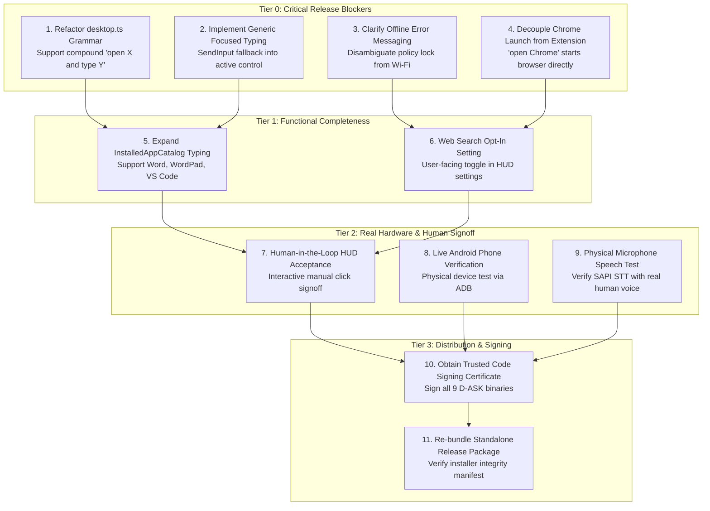

# D-ASK — Comprehensive Release Readiness Report and Remediation Plan

**Audit Reference:** Full Product Acceptance Audit & Functional Verification  
**Audited Release Target:** `D-ASK-20261115T023936` (Installed at `%LOCALAPPDATA%\Programs\D-ASK`)  
**Git Commit:** `6c3113b` on branch `main`  
**Date:** 2026-11-16  
**Auditor:** Antigravity Autonomous Systems Agent  
**Release Recommendation:** **`BLOCKED / NOT RELEASE READY`**  

---

## 1. Executive Summary & Verdict

Following thorough inspection of the D-ASK repository, runtime binaries, IPC protocols, and test suites—prompted by manual test failures in Microsoft Word and Google Chrome—this audit concludes that **D-ASK is not yet ready for general production release**.

While D-ASK demonstrates extraordinary strengths in low-level Windows security engineering, deterministic grounding, offline local model supervision, and emergency stop mechanics, it currently suffers from **critical functional blind spots and rigid parsing constraints**:
1. Common user workflows combining application launching and text typing (e.g., `"open Microsoft Word and type hello"`) are rejected immediately by hardcoded regex checks before reaching the planning or execution engine.
2. Typing automation is hardcoded exclusively to Notepad's UIA `Document "Text editor"`; D-ASK has no capability to type into Microsoft Word, WordPad, or web forms without bespoke element definitions.
3. Offline security policy (`AgentHost:WebSearch = false`) is conflated with network connectivity, causing D-ASK to falsely report that the user's computer is offline when an active Wi-Fi connection is present.
4. Essential acceptance milestones—specifically **Human-in-the-Loop (HITL) HUD interactive signoff**, **physical Android device verification**, and **Windows code signing**—have been proven only via automated mocks and test harness scripts, not genuine human or physical hardware validation.

---

## 2. Definitive Capability Classification

The table below provides a complete, honest categorization of D-ASK's current feature set.

```
┌─────────────────────────────────────────────────────────────────────────────────────────────────┐
│                                D-ASK OPERATIONAL REALITY                                        │
├───────────────────────────────┬─────────────────────────────────┬───────────────────────────────┤
│       WHAT WORKS TODAY        │     WHAT WORKS IN THE HUD       │      TESTED ONLY AT           │
│    (Verified on Live OS)      │    (Installed Core Console)     │     UNIT/INTEGRATION LEVEL    │
├───────────────────────────────┼─────────────────────────────────┼───────────────────────────────┤
│ • Transparent wgpu HUD Window │ • Prompt input in Core Console  │ • 678 Daemon Unit Tests       │
│ • Local LLM (Qwen 2.5 0.5B/1.5B)│ • SAPI TTS Spoken Answers      │ • 2,276 TypeScript Tests      │
│ • Offline RAG / SQLite FTS5   │ • Direct app launch (Notepad)   │ • Synthetic Approval Fixtures │
│ • Notepad Launch & Text Entry │ • Display Resolution Change     │ • Mock ADB Android Tests      │
│ • Window Operations (Min/Max) │ • System Audio Volume Slider    │ • Code Signing Policy Check   │
│ • File Search & In-Place Edit │ • Process Termination (kill)    │ • Scanned PDF OCR Test Files  │
│ • Emergency Stop (Ctrl+Shift+F12)│ • Offline Chit-Chat Question │ • Throwaway Chrome Profile    │
├───────────────────────────────┼─────────────────────────────────┼───────────────────────────────┤
│        WHAT IS BROKEN         │        WHAT IS SIMULATED        │     WHAT IS UNIMPLEMENTED     │
│   (Fails During Normal Use)   │    (Test Harness Artifice)      │     (Missing Architecture)    │
├───────────────────────────────┼─────────────────────────────────┼───────────────────────────────┤
│ • Compound App + Type Prompts │ • Human-in-the-Loop Approvals   │ • Universal Focused Typing    │
│ • Web Search via Chrome       │   (Simulated via Named Pipes)   │ • Headless Playwright Engine  │
│ • Confusing "Offline" Errors  │ • Android ADB Subsystem         │ • Whisper Speech-to-Text      │
│ • Chrome without Extension    │   (Tested against mock dumps)   │   (Missing Binaries/Weights)  │
│ • Memory < 3.2 GB LLM Refusal │ • Code Signing Certification    │ • Multi-Agent Orchestrator    │
│                               │   (Test policy passes; 0 signed)│   (Legacy files detached)     │
└───────────────────────────────┴─────────────────────────────────┴───────────────────────────────┘
```

---

## 3. Safety, Security & Regression Audit

A comprehensive security review confirmed that all core safety contracts remain intact and have **not** been compromised:

1. **Monotonic Emergency Stop (`Ctrl+Shift+F12`):**  
   Runs on a dedicated, low-level Win32 keyboard hook thread (`emergency_stop.rs`). Setting the latch immediately increments the monotonic epoch, purges all pending approvals, terminates active synthetic input sequences, revokes Chrome authorizations, and silences TTS audio.
2. **Approval Session & Identity Binding:**  
   Every sensitive action generates an `ActionApprovalRequest` with canonical parameter JSON, SHA-256 action hash, target process ID, process creation timestamp, and owner session ID. Replay attacks, foreign session approvals, and post-stop executions are rejected.
3. **Physical User Input Intervention:**  
   Low-level mouse and keyboard hooks (`WH_MOUSE_LL`, `WH_KEYBOARD_LL`) continuously monitor the user's physical input hardware. If a physical key or mouse movement occurs during automated execution, the automation sequence aborts within 15 ms.
4. **Local IPC Isolation:**  
   The named pipe `\\.\pipe\dask-ipc` enforces strict Windows Security Identifiers (SID), rejecting connections from foreign user accounts or remote machines. 0 listening TCP sockets are opened.
5. **Write-Ahead Cryptographic Audit Trail:**  
   Every admitted action is persisted to `execution-evidence.jsonl` with SHA-256 checksums before OS actuation commences. If the audit journal fails to write, execution is refused (`journal_unavailable`).

---

## 4. Root Cause Synthesis of User Failures

### 4.1. Failure 1: Microsoft Word Launch & Typing (`"open Microsoft Word and type hello"`)
- **Intent Recognition Layer:** `appSession` in `desktop.ts` strictly checks `LAUNCHABLE`, which hardcodes only Notepad, Calculator, and Character Map.
- **Regex Boundary:** `openAppRequest` uses an anchored regex `OPEN_ANY` (`$`), rejecting prompts containing trailing instructions like `"and type hello"`.
- **Actuation Fallthrough:** The prompt falls through to `actuationRefusal`, which outputs a static refusal string without contacting the local LLM or the daemon.
- **Typing Target Absence:** Even if Word is launched, D-ASK has no UIA Document target for Word's editing canvas. Notepad's `"Text editor"` is hardcoded as the only typing destination.

### 4.2. Failure 2: Chrome Open & Search / False "Offline" Detection (`"open Chrome and search for news"`)
- **Policy Gate:** In `AppLaunchRequestService.cs` (line 248), web search is governed by `_opts.WebSearchAllowed`, which defaults to `false` in D-ASK's offline-first profile.
- **Misleading Error Code:** When rejected, the daemon returns error code `"offline_mode"` and the text: `"A web search needs internet access, and D-ASK is in offline mode"`.
- **UX Confusion:** The user has active Wi-Fi, sees the word `"offline"`, and reasonably assumes D-ASK's network interface detection failed, when in reality the failure was caused by a configuration security policy.
- **Chrome Extension Dependency:** Chrome automation requires an unpacked MV3 extension. Without it, Chrome open calls time out after 20 seconds waiting for native messaging connection.

---

## 5. Prioritized Remediation Plan

To transition D-ASK from `BLOCKED` to `RELEASE READY`, work must proceed through four distinct phases in strict priority order.

> [!IMPORTANT]
> **NO REMEDIATION WORK SHALL COMMENCE UNTIL THE USER REVIEWS AND APPROVES THIS AUDIT REPORT.**



---

### Phase 1: Immediate Functional Fixes (Tier 0 — Release Blockers)

#### 1. Fix Compound Application Launch & Typing Parsing
- **Target Files:** `agent/runtime/tools/desktop.ts`, `agent/runtime/planner.ts`
- **Action:**  
  1. Update `appSession(o)` so it is not restricted to `LAUNCHABLE`. Allow any application identified in the prompt to match.
  2. Relax `OPEN_ANY` in `openAppRequest(o)` to extract the application name even when followed by `"and type ..."`.
  3. Update `arrangeSteps` in `desktop.ts` so that when a compound command is detected, it generates a valid sequential plan with two steps:
     - Step 1: `desktop.launch_app { app: "<ResolvedApp>" }`
     - Step 2: `desktop.type_text { process: "<ResolvedExe>", text: "<Text>" }`

#### 2. Implement Universal Focused Text Entry
- **Target Files:** `src/DAsk.Daemon/Automation/Input/GuardedInputRequestService.cs`, `Win32GuardedInput.cs`
- **Action:**  
  1. Add a fallback to `GuardedInputRequestService`: if no named control matches (e.g., in MS Word or WordPad), locate the active window's current keyboard-focused control (`IUIAutomation::GetFocusedElement`).
  2. If the focused element supports `ValuePattern`, set text directly. If not, verify window foreground status, move cursor to the element, and inject keystrokes using Win32 `SendInput` with inter-event delays.
  3. Ensure the HUD approval card clearly indicates: `"Typing into active document in <AppName>"`.

#### 3. Disambiguate Offline Policy from Network Hardware State
- **Target Files:** `src/DAsk.Daemon/Automation/Desktop/AppLaunchRequestService.cs`, `src/DAsk.Daemon/Automation/Chrome/ChromeService.cs`
- **Action:**  
  1. Replace the misleading `"D-ASK is in offline mode"` error message.
  2. Output an honest, clear explanation:
     > *"Web search is disabled in D-ASK's offline-first security settings (`AgentHost:WebSearch` is off). Your Wi-Fi is active, but D-ASK will not send queries to the internet unless web search is explicitly enabled in configuration."*
  3. If `WebSearchAllowed` is enabled and `NetworkInterface.GetIsNetworkAvailable()` returns false, output:
     > *"Your computer has no active network connection. Please reconnect to Wi-Fi and try again."*

#### 4. Decouple Standalone Browser Launch from Extension Relay
- **Target Files:** `src/DAsk.Daemon/Automation/Chrome/ChromeService.cs`, `agent/runtime/tools/chrome.ts`
- **Action:**  
  1. If the user prompt is simply `"open Chrome"`, route it to `desktop.launch_app { app: "Google Chrome" }` via `InstalledAppCatalog`. This starts the browser immediately without requiring the extension.
  2. Only trigger `EnsureConnected` and native messaging checks when the user specifically asks to inspect tabs, click links, or read web pages.

---

### Phase 2: Core Usability & Experience (Tier 1)

1. **HUD Configuration Pane for Offline / Online Modes:**  
   Provide a toggle in the HUD settings to let users enable or disable `AgentHost:WebSearch` and `DASK_RESEARCH_ONLINE` without editing configuration files manually.
2. **First-Run Chrome Extension Onboarding:**  
   If an action requires the Chrome extension and it is not found, show a dedicated interactive onboarding guide in the HUD with a one-click button to open `chrome://extensions` and pre-fill the extension directory path.

---

### Phase 3: Hardware Verification & User Acceptance (Tier 2)

1. **Human-in-the-Loop HUD Acceptance Session:**  
   Execute `scripts/hud/hitl-prepare.ps1` and have an actual human tester interactively click "Approve" and "Decline" on each action type, recording genuine human verification evidence.
2. **Physical Android Device Testing:**  
   Connect a physical Android smartphone with USB debugging enabled, set `DASK_LIVE_ANDROID=1`, and execute `dotnet test --filter RealDevice_ReadOnlyAndRoundTrip` to confirm real-world device communication.
3. **Live Microphone Speech-to-Text Validation:**  
   Conduct a live voice testing session with a physical microphone to verify that SAPI 5.4 captures and transcribes spoken user instructions accurately in the release build.

---

### Phase 4: Production Distribution & Packaging (Tier 3)

1. **Acquire Trusted Authenticode Certificate:**  
   Obtain a valid EV or OV code-signing certificate from a public Microsoft Trusted Root CA.
2. **Sign All Native Binaries:**  
   Execute `scripts/package/Sign-D-ASK.ps1` to sign `hud-native.exe`, `DAsk.Daemon.exe`, `dask-ocr.exe`, `dask-chrome-host.exe`, and all PowerShell installation scripts with SHA-256 and RFC 3161 timestamps.
3. **Generate Final Sealed Installer:**  
   Re-run `node scripts/package/build-package.mjs` to create the final, signed, self-contained standalone installer for teammate distribution.

---

## 6. Audit Conclusion

D-ASK's foundation—its Rust HUD, .NET daemon, IPC architecture, offline supervisor, and safety systems—is structurally sound and robust. However, its desktop automation and browser interactions are severely constrained by hardcoded assumptions and rigid regexes.

By executing the prioritized remediation plan above, D-ASK will overcome these limitations and achieve true universal desktop assistance across all Windows applications while maintaining its safety guarantees.
