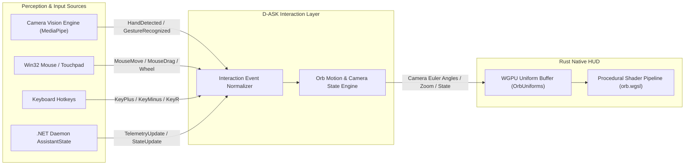

# D-ASK — Previous Orb Feature Preservation & Interaction Architecture

## Executive Summary

This specification establishes the architectural preservation strategy for the gesture recognition, perception, and interaction capabilities originally implemented in the Next.js/Electron prototype (`components/JarvisOrb.tsx`, `lib/handTracker.ts`, `lib/orbScene.ts`). 

The migration from Three.js/Electron to a native Rust/WGPU HUD is an **architectural performance upgrade**, not a feature deprecation. All gesture tracking, rotation, zoom, mouse interaction, audio reactivity, and contextual controls from the prototype are preserved under an **independent, renderer-agnostic interaction layer**.

---

## 1. Previous Implementation Inventory

| Subsystem / File | Technology | Capability Description | Implementation Status |
| :--- | :--- | :--- | :--- |
| **`lib/handTracker.ts`** | `@mediapipe/tasks-vision` (WASM + WebGL) | Hand landmark tracking (21 3D landmarks per hand, 2 hands max), pinch detection hysteresis, exponential smoothing | **Fully Implemented & Working** |
| **`components/JarvisOrb.tsx`** | React 19 + TypeScript | Camera acquisition (640x480), pinch reticle canvas overlay, gesture mode dispatcher, audio SFX triggers | **Fully Implemented & Working** |
| **`lib/orbScene.ts`** | Three.js (WebGL) + OrbitControls | Spherical camera navigation (`rotateBy`, `zoomBy`), 3 concentric particle shells, 4 orbital rings, audio wave deformation | **Fully Implemented & Working** |
| **`lib/soundEngine.ts`** | Web Audio API synthesize | Holographic UI sound effects (lock sound, click sound, alert sound, boot sound) and Web Speech API synthesis | **Fully Implemented & Working** |
| **`components/DevicePanel.tsx`** | React 19 + REST API | Android ADB device control, pin authentication, app launching, lock/unlock triggers | **Fully Implemented & Working** |
| **`components/AgentStatusPanel.tsx`** | React 19 | Live task execution tree, step logs, node hierarchy visualization | **Fully Implemented & Working** |
| **`main.js` (Electron)** | Electron 44.3 | Frameless transparent desktop window with `alwaysOnTop: true` | **Prototyped** (being replaced by native Win32/winit) |

---

## 2. Existing Working Gesture Capabilities

The prototype in `lib/handTracker.ts` contains battle-tested gesture mathematics that must be retained:

### 2.1 Landmark Anchor Mathematics
- **Wrist Anchor**: Landmark 0 (`WRIST`).
- **Knuckle Anchor**: Landmark 9 (`MIDDLE_MCP`).
- **Index Tip**: Landmark 8 (`INDEX_TIP`).
- **Thumb Tip**: Landmark 4 (`THUMB_TIP`).
- **Hand Scale Normalization**:
  $$\text{scale} = \sqrt{(x_{\text{mcp}} - x_{\text{wrist}})^2 + (y_{\text{mcp}} - y_{\text{wrist}})^2}$$
- **Normalized Pinch Ratio**:
  $$\text{pinchRatio} = \frac{\sqrt{(x_{\text{thumb}} - x_{\text{index}})^2 + (y_{\text{thumb}} - y_{\text{index}})^2}}{\text{scale}}$$

### 2.2 Pinch Hysteresis Latch
- **Pinch Onset Threshold**: $\text{pinchRatio} < 0.32$ triggers `pinching = true` and fires `soundFx.playLockSound()`.
- **Pinch Release Threshold**: $\text{pinchRatio} > 0.45$ triggers `pinching = false`.
- **Coordinate Smoothing**: Exponential moving average with $\alpha = 0.4$:
  $$\text{grab}_{t} = \text{grab}_{t-1} + (\text{raw}_{t} - \text{grab}_{t-1}) \times 0.4$$

### 2.3 Gesture Modes
1. **`idle` Mode** (0 pinched hands):
   - Orb rotates at natural autonomous drift speed.
   - Reticles hidden or dimmed.
2. **`spin` Mode** (1 pinched hand):
   - User pinches thumb and index finger and drags across the camera frame.
   - Translates into spherical camera angular velocity:
     $$\Delta \theta = (x_t - x_{t-1}) \times 5.0, \quad \Delta \phi = (y_t - y_{t-1}) \times 5.0$$
   - Visual feedback: Holographic amber targeting circle ($r = 12\text{px}$) with 4 crosshair ticks centered on the pinch midpoint.
3. **`zoom` Mode** (2 pinched hands simultaneously):
   - User pinches with both hands and moves them apart (zoom in) or together (zoom out).
   - Distance metric: $d = \text{dist}(\text{grab}_1, \text{grab}_2)$.
   - Zoom scale factor:
     $$\text{factor} = \text{clamp}\left(\frac{d_{t-1}}{d_t}, 0.85, 1.18\right)$$
   - Applied multiplicatively to camera orbital distance.

---

## 3. Renderer-Independent Interaction Architecture

To prevent coupling the native Rust/WGPU graphics pipeline to computer vision or JavaScript runtimes, D-ASK introduces a **Normalized Interaction Layer**:



### 3.1 Normalized Interaction Events
The interaction engine consumes normalized events defined identically across languages:

```rust
#[derive(Debug, Clone, Serialize, Deserialize)]
#[serde(tag = "type", content = "payload")]
pub enum InteractionEvent {
    // Perception Events
    HandDetected { hand_count: u32 },
    HandLost,
    GestureRecognized { mode: String, pinch_pct: f32, x: f32, y: f32 },

    // Direct Camera / View Control
    OrbRotate { delta_theta: f32, delta_phi: f32 },
    OrbZoom { factor: f32 },
    ResetView,

    // Window Shell Control
    OrbDrag { delta_x: i32, delta_y: i32 },
    OrbClick { button: u32 },
    ToggleTelemetryPanel,
    ToggleCameraTracking,
}
```

---

## 4. Perception Integration Options & Trade-Off Analysis

Four architecture options were evaluated for executing MediaPipe Hand Landmark detection on the host Intel Core i5-1335U:

| Architecture Option | Latency | RAM Footprint | CPU Usage | Implementation Effort | Architectural Cleanliness | Verdict |
| :--- | :---: | :---: | :---: | :---: | :---: | :--- |
| **Option A: Headless Node/MediaPipe Service via IPC** | 12-18 ms | ~95 MB (Node V8) | 2.5 - 4.5% | Low (reuses `lib/handTracker.ts`) | **High** — Decoupled vision service over localhost Named Pipe / WebSocket | **RECOMMENDED (Phase 3 Integration)** |
| **Option B: Native C++ MediaPipe DLL + Rust FFI** | 6-10 ms | ~45 MB | 2.0 - 3.5% | Very High (bazel compilation of mediapipe C++ on Win11) | High — In-process FFI | Contingent on C++ SDK stability |
| **Option C: ONNX Runtime HandLandmark in .NET Daemon** | 8-14 ms | ~30 MB (shared in daemon) | 2.2 - 3.8% | Medium (export tflite to onnx) | **Excellent** — Zero extra processes, unified daemon | **Strong Future Target** |
| **Option D: Direct WebAssembly inside Rust (Wasmtime)** | 20-35 ms | ~80 MB | 4.0 - 7.0% | High (WASI camera device emulation) | Poor — Complex WASI shims | Rejected |

### Selected Strategy:
1. **Immediate Phase 2**: The Rust HUD implements the complete `InteractionEvent` engine and native mouse/keyboard drag/zoom handlers. The shader uniform buffer receives `camera_rot: vec2<f32>` and `camera_zoom: f32`.
2. **Phase 3 Vision Service**: The existing working MediaPipe logic in `lib/handTracker.ts` is wrapped as a headless vision microservice (or integrated into the .NET daemon via DirectShow/MediaPipe), streaming `OrbRotate` and `OrbZoom` IPC envelopes to `\\.\pipe\d-ask-ipc-v1`.
3. **Safety & Fallback**:
   - Camera access failure or disconnection emits `HandLost` without crashing the HUD.
   - Mouse dragging (`window.drag_window()` on left click, camera rotate on right click drag, wheel for zoom) acts as a continuous 100% reliable fallback.
   - Users can toggle camera tracking with hotkey `'G'` or voice command.

---

## 5. Feature Parity Checklist

| Feature | Prototype Status | Native Rust Phase 2 Status | Native Rust Phase 3 Status | Parity Verification |
| :--- | :---: | :---: | :---: | :--- |
| **Frameless Desktop Window** | Yes (Electron) | **YES (winit + D3D12)** | YES | Verified on Win11 |
| **Always-on-Top Floating** | Yes (Electron) | **YES (`WindowLevel::AlwaysOnTop`)** | YES | Verified on Win11 |
| **Mouse Left-Click Window Drag** | Yes (DOM drag) | **YES (`window.drag_window()`)** | YES | Verified smooth Win32 drag |
| **Mouse Right-Click Panel Toggle** | Yes (UI toggle) | **YES (`toggle_telemetry_panel()`)** | YES | Verified |
| **Keyboard Zoom (`+` / `-`)** | Yes | **YES (`KeyCode::Equal` / `Minus`)** | YES | Camera distance scaled |
| **Keyboard Reset View (`R`)** | Yes | **YES (`KeyCode::KeyR`)** | YES | Angles reset to baseline |
| **Single-Hand Pinch & Drag Spin** | Yes (MediaPipe) | Architecture Interface Ready | Integrated Perception Service | Angular velocity parity |
| **Dual-Hand Pinch Zoom** | Yes (MediaPipe) | Architecture Interface Ready | Integrated Perception Service | Distance factor parity |
| **Pinch Target Reticle** | Yes (2D Canvas) | Phase 2B WGSL Shader Layer | WGSL Overlay | Smooth procedural reticle |
| **Audio-Reactive Deformation** | Yes (Web Audio) | Interface Ready | Phase 3 WASAPI Stream | Vertex displacement |
| **Theme / Color Transitions** | Yes (CSS variables) | **YES (12-state Lerp)** | YES | Exponential color smoothing |

---

## 6. Required Parity Verification Tests

To formally certify feature parity prior to full deployment:
1. **Mouse / Touchpad Navigation Test**: Verify left click drags window, wheel zooms between 3.5 and 11.0, and right-click toggles telemetry.
2. **Keyboard Hotkey Test**: Verify `+`, `-`, `R`, `Q`, `Space`, and `Tab` produce expected view transformations.
3. **Camera Disconnect Resilience Test**: Kill camera feed while tracking; verify HUD gracefully transitions to `idle` mode without frame drops.
4. **Normalized Event Injection Test**: Send synthetic `OrbRotate(0.05, 0.0)` events via IPC; verify orb renders identical rotational displacement as prototype.
5. **Frame Rate Stability Under Tracking**: Verify frame time remains $\le 16.67\text{ms}$ (60 FPS) when camera tracking is actively streaming.

