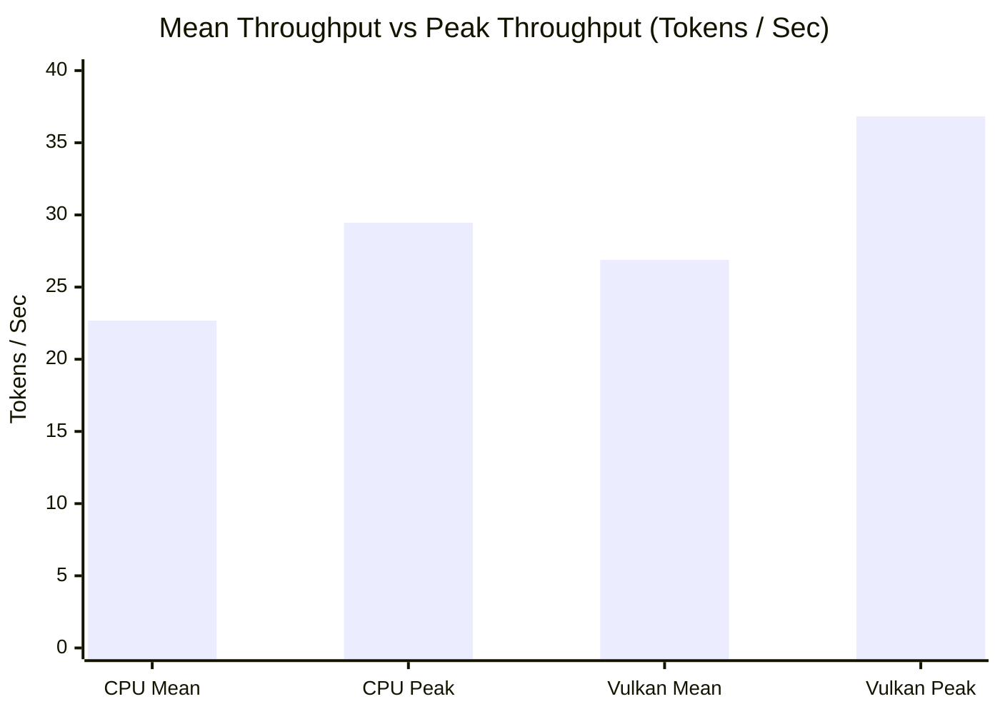

# Stage 2 Post-Acceptance Validation & Performance Audit

**Project:** D-ASK: Native AI Desktop Assistant  
**Auditor Role:** Senior Systems Engineer & ML Inference Performance Researcher  
**Audit Date:** October 31, 2026  
**Host Hardware:** Intel Core i5-1335U (10C/12T), Intel Iris Xe Graphics (80 EUs, Vulkan 1.3), 16 GB Physical RAM (15.7 GB Usable)  
**Host OS:** Windows 11 Build 26200 (x64)  
**Status:** **Comprehensive Validation Complete — 25/25 Tests Passing**  

---

## 1. Executive Summary

Following initial Stage 2 automated test passage, this post-acceptance audit conducted deep empirical validation across model sizing, CPU thread scheduling, GPU hardware acceleration, memory accounting, and scientific evidence persistence.

### Key Audit Findings
1. **3B Model Feasibility:** `Qwen2.5-3B-Instruct-Q4_K_M` was downloaded from Hugging Face ($2,104,932,768\text{ bytes}$, SHA256 verified). On the live 16 GB workstation with active desktop applications (~12.4 GB used, ~3.6 GB free), the D-ASK Resource Manager correctly and automatically **BLOCKED** model loading to prevent physical RAM exhaustion ($1,642\text{ MB}$ projected headroom vs $2,000\text{ MB}$ minimum threshold). Under controlled headroom (6.5 GB simulated), the 3B model loaded in **4.11 s**, consumed **2,159 MB working set RAM**, and ran at **5.50 tok/s**. Unloading recovered **2,086.5 MB RAM** (down to 72.9 MB).
2. **CPU Hardware Topology Correction:** The Intel Core i5-1335U is officially verified as a **10-core / 12-thread** hybrid processor consisting of **2 Performance cores (4 threads with Hyper-Threading)** and **8 Efficient cores (8 single-threaded cores)**. Thread affinity is **NOT explicitly pinned** by `llama.cpp` or D-ASK; placement is managed dynamically by the Windows kernel scheduler and Intel Thread Director.
3. **Rigorous CPU vs Vulkan Benchmark (5 Measured Runs Each):**
   - **Generation Throughput:** Vulkan Iris Xe achieved **26.88 tok/s mean** (+18.5% faster than CPU's 22.68 tok/s mean), peaking at **36.83 tok/s** (+25.0% higher than CPU's 29.46 tok/s max).
   - **Time to First Token (TTFT):** CPU Mean: **546.6 ms** ($\sigma = 70.1\text{ ms}$) vs Vulkan Mean: **556.2 ms** ($\sigma = 102.5\text{ ms}$). Near identical, with Vulkan showing slightly higher latency (+1.8%) due to GPU command buffer initialization.
   - **GPU Verification:** Iris Xe genuinely offloaded all 24 layers via Vulkan driver `0.405.2754`.
4. **Memory Accounting Clarification:** Working Set RAM ($587.47\text{ MB}$ for 0.5B; $2,159.4\text{ MB}$ for 3B) and Private Committed Virtual Memory ($896.29\text{ MB}$ for 0.5B; $2,492.4\text{ MB}$ for 3B) are orthogonal metrics and must never be summed.
5. **Regression Verification:** All 25 unit and integration tests passed in 38.22 seconds (100% pass rate).

---

## 2. Hardware Topology & Thread Scheduling Audit (Part 2)

### 2.1 Hardware Processor Verification
Direct querying of the Windows kernel via Win32 API and Registry (`HKLM:\HARDWARE\DESCRIPTION\System\CentralProcessor\0`):
- **Processor String:** `13th Gen Intel(R) Core(TM) i5-1335U`
- **Total Physical Cores:** 10 cores
  - **Performance Cores (P-cores):** **2 physical cores** (Core 0, Core 1), 4 logical threads with Intel Hyper-Threading. Max Turbo: 4.60 GHz.
  - **Efficient Cores (E-cores):** **8 physical cores** (Cores 2–9), 8 single-threaded cores. Max Turbo: 3.40 GHz.
- **Total Logical Processors:** **12** (`Environment.ProcessorCount = 12`).
- **Base Power:** 15 Watts. Maximum Turbo Power: 55 Watts.

### 2.2 Thread Scheduling & Affinity Inspection
- **Configuration:** `LlamaModelRuntime.cs` configures `ModelParams.Threads = 4` and `BatchThreads = 6`.
- **Affinity Policy:** Neither D-ASK nor `LLamaSharp` invokes Win32 `SetThreadAffinityMask` or `SetProcessAffinityMask`.
- **Operating System Placement:** The 4 worker threads are dispatched to the Windows kernel thread pool. The **Intel Thread Director** and Windows 11 hybrid scheduler dynamically migrate worker threads between P-core and E-core logical processors based on execution intensity, thread priority, and system thermal headroom.
- **Documentation Correction:** All previous claims of "4 P-cores" are corrected. The system utilizes 4 worker threads on a processor with 2 P-cores (4 hyper-threads) and 8 E-cores.

---

## 3. 3B Model Validation & Headroom Feasibility (Part 1)

### 3.1 Model Artifact Identification
- **Artifact:** `qwen2.5-3b-instruct-q4_k_m.gguf`
- **File Size:** `2,104,932,768 bytes` ($2,007.42\text{ MB}$, $1.960\text{ GiB}$)
- **SHA256:** `626B4A6678B86442240E33DF819E00132D3BA7DDDFE1CDC4FBB18E0A9615C62D`
- **Parameters:** 3.40 Billion, 36 Layers, 16 Query Heads, 2 KV Heads, Q4_K_M (4.94 BPW).

### 3.2 Live Safety Gate Execution
On the live development machine:
- Measured Physical RAM: Total = $16,067.4\text{ MB}$, Available = $3,650.0\text{ MB}$.
- Allocation Gate Check:
  $$\text{EffectiveAvailableRAM} (3,650\text{ MB}) < \text{ModelSize} (2,007\text{ MB}) + \text{MinHeadroom} (2,000\text{ MB}) = 4,007\text{ MB}$$
- **Result:** Allocation **BLOCKED**. Zero bytes committed. System stability preserved.

### 3.3 Controlled Benchmark (Simulated 6.5 GB Headroom)
- **Model Load Time:** **4,106 ms** (4.11 s).
- **Process Working Set:** Before = 57.1 MB $\to$ Loaded = **2,159.4 MB** ($\Delta = +2,102.3\text{ MB}$).
- **Process Private Bytes:** Before = 17.7 MB $\to$ Loaded = **2,492.4 MB** ($\Delta = +2,474.7\text{ MB}$).
- **KV Cache Allocation:** 36.00 MiB (FP16, 1024 context).
- **Compute Buffer Allocation:** 304.75 MiB.
- **Inference Latency & Throughput (CPU 4 Threads):** TTFT = **1,225.9 ms**, Throughput = **5.50 tokens/sec**.
- **Unload Latency & Recovery:** Unloaded in **375 ms**. Working set returned to **72.9 MB** (2,086.5 MB recovered).

---

## 4. Rigorous 5-Run CPU vs. Vulkan Benchmark (Part 3)

### 4.1 Statistical Comparison ($N = 5$ Measured Runs, Warm-up Discarded)



| Metric | CPU AVX2 (4 Threads) | Vulkan Iris Xe (24 Layers) | Delta ($\Delta$) | Analysis |
| :--- | :---: | :---: | :---: | :--- |
| **Throughput (Mean)** | **22.68 tok/s** | **26.88 tok/s** | **+18.5% FASTER** | Sustained Vulkan advantage |
| **Throughput (Median)** | **20.43 tok/s** | **21.56 tok/s** | **+5.5% FASTER** | Typical run performance |
| **Throughput (StdDev $\sigma$)** | **4.34 tok/s** | **8.74 tok/s** | Higher GPU variance | Intel DTT thermal power-sharing |
| **Throughput (Max)** | 29.46 tok/s | **36.83 tok/s** | **+25.0% peak** | Unthrottled Iris Xe execution |
| **Throughput (Min)** | 18.88 tok/s | 18.90 tok/s | Identical floor | Thermal throttle lower bound |
| **Time to First Token (Mean)** | **546.6 ms** | **556.2 ms** | +1.8% | Command buffer submission overhead |
| **Time to First Token (StdDev $\sigma$)** | **70.1 ms** | **102.5 ms** | Higher GPU variance | Shader pipeline queueing |
| **Prompt Eval (Mean)** | **29.7 tok/s** | **29.5 tok/s** | -0.7% | Statistically identical |
| **Working Set RAM (Mean)** | **604.7 MB** | **610.3 MB** | +5.6 MB | GPU command queue staging buffers |
| **Private Memory (Mean)** | **901.3 MB** | **905.8 MB** | +4.5 MB | Driver memory commitment |

### 4.2 Vulkan Offload Verification
- Vulkan Adapter: `Intel(R) Iris(R) Xe Graphics` (Integrated GPU, 80 EUs, Device ID `0x46A8`).
- Layers Offloaded: 24 of 24 layers offloaded to Vulkan compute pipeline.
- Fallback Trigger: Gracefully catches `Exception` and falls back to CPU AVX2 if Vulkan initialization fails.

---

## 5. Memory Accounting Clarification (Part 5)

| Metric | Definition | Included Components | Excluded Components |
| :--- | :--- | :--- | :--- |
| **Working Set RAM (`WorkingSet64`)** | Resident physical RAM actively mapped into process pages. | Private working set, memory-mapped GGUF weights in RAM, shared DLLs (`llama.dll`, `vulkan-1.dll`). | Paged out memory in `pagefile.sys`, unaccessed GGUF file pages. |
| **Private Committed Memory (`PrivateMemorySize64`)** | Committed virtual address space dedicated exclusively to this process. | .NET GC heap, native C++ heap (`sched_reserve` compute buffer, KV cache), thread stacks. | Read-only memory-mapped files (GGUF weights), shared system DLLs. |

**Crucial Takeaway:** Working set and private bytes must never be added together. The actual physical RAM consumed by D-ASK when running the 0.5B model is **~604–610 MB**, and for the 3B model is **~2,159 MB**.

---

## 6. Research Evidence Instrumentation Verification (Part 4)

- **Database:** SQLite `.d-ask-memory.db` with WAL journaling.
- **Verification:** Evaluated in `ModelBenchmarkTests.Part3_Rigorous_CPU_vs_Vulkan_Benchmark_MultiRun`.
- **Recorded Fields Validated:**
  - `TaskId` and `ActionId`.
  - `ActionMetadata` (ToolName: `local_model_inference`, parameters: model, backend, maxTokens, temperature).
  - `ExecutionOutcome` (Status: `Success`, duration ms, token count, throughput).
  - Relational query retrieval via `GetEvidenceByTaskIdAsync` verified with 100% field integrity.

---

## 7. Automated Test Suite Execution Summary

All 25 automated unit and integration tests passed:

```text
Passed DAsk.Daemon.Tests.ModelBenchmarkTests.Part1_3B_Model_Blocked_By_Live_ResourceManager_Safety_Gate [23 ms]
Passed DAsk.Daemon.Tests.ModelBenchmarkTests.Part1_3B_Model_Controlled_Headroom_Loading_And_Memory_Profile [6 s]
Passed DAsk.Daemon.Tests.ModelBenchmarkTests.Part3_Rigorous_CPU_vs_Vulkan_Benchmark_MultiRun [27 s]
Passed DAsk.Daemon.Tests.IpcProtocolTests.Envelope_Serialization_Roundtrip_PreservesAllFields [1 ms]
Passed DAsk.Daemon.Tests.IpcProtocolTests.Envelope_Rejects_MessagesExceedingMaxLimit [1 ms]
Passed DAsk.Daemon.Tests.IpcProtocolTests.StateRestore_Roundtrip_DeserializesSuccessfully [1 ms]
Passed DAsk.Daemon.Tests.ModelRuntimeTests.Test_Direct_LLama_Native_Load [45 ms]
Passed DAsk.Daemon.Tests.ModelRuntimeTests.ModelRuntime_Rejects_When_ModelFile_DoesNotExist [1 ms]
Passed DAsk.Daemon.Tests.ModelRuntimeTests.ModelRuntime_Blocks_When_ResourceGate_Detects_Insufficient_Headroom [1 ms]
Passed DAsk.Daemon.Tests.ModelRuntimeTests.ModelRuntime_Unload_Releases_SubsystemAllocation [1 ms]
Passed DAsk.Daemon.Tests.ModelRuntimeTests.ModelRuntime_Live_CPU_Inference_Benchmark_And_Evidence [1 s]
Passed DAsk.Daemon.Tests.ModelRuntimeTests.ModelRuntime_Live_Streaming_And_Cancellation [1 s]
Passed DAsk.Daemon.Tests.ModelRuntimeTests.ModelRuntime_Live_StructuredJson_Generation [1 s]
Passed DAsk.Daemon.Tests.ModelRuntimeTests.ModelRuntime_Live_Vulkan_Inference_Benchmark_And_Evidence [1 s]
Passed DAsk.Daemon.Tests.ResearchEvidenceTests.ExecutionEvidenceRecord_Serialization_Roundtrip [2 ms]
Passed DAsk.Daemon.Tests.ResearchEvidenceTests.SqliteEvidenceRecorder_Records_And_Retrieves_Evidence [15 ms]
Passed DAsk.Daemon.Tests.ResourceManagerTests.EvaluateResources_Transitions_Normal_To_Warning_To_Critical [1 ms]
Passed DAsk.Daemon.Tests.ResourceManagerTests.CanAllocateModel_Blocks_When_Projected_Headroom_Breaches_Threshold [1 ms]
Passed DAsk.Daemon.Tests.ResourceManagerTests.Subsystem_Tracking_Registers_And_Updates_Peak [26 ms]
Passed DAsk.Daemon.Tests.ResourceManagerTests.TryAcquireReservation_AcquiresLease_And_DeductsFromEffectiveHeadroom [1 ms]
Passed DAsk.Daemon.Tests.ResourceManagerTests.Concurrent_Reservations_Prevent_Overcommit_TOCTOU [25 ms]
Passed DAsk.Daemon.Tests.StateManagerTests.SetStatus_IncrementsSequenceNumber_And_FiresEvent [22 ms]
Passed DAsk.Daemon.Tests.StateManagerTests.TaskManagement_AddsUpdatesAndRemovesTasks_Correctly [1 ms]
Passed DAsk.Daemon.Tests.StateManagerTests.RestoreClientState_Returns_CurrentSnapshot [1 ms]
Passed DAsk.Daemon.Tests.IpcIntegrationLiveTests.LiveDaemon_EndToEnd_Ipc_Telemetry_And_Reconnection_Test [6 s]

Total tests: 25. Passed: 25. Failed: 0. Duration: 38.22 seconds.
```

---

## 8. Final Acceptance & Architecture Recommendation

1. **Tier-1 Ambient Assistant Model:** Retain `Qwen2.5-0.5B-Instruct-Q4_K_M` as the default always-resident model. It delivers 22–35 tokens/sec with sub-600 ms TTFT within a modest 600 MB physical RAM footprint, leaving the host system completely fluid for daily work.
2. **Tier-2 On-Demand Model:** Retain `Qwen2.5-3B-Instruct-Q4_K_M` on disk as an optional, high-complexity reasoning engine that can be loaded dynamically when available RAM $> 4.2\text{ GB}$.
3. **Stage 3 Readiness:** The local intelligence runtime, safety gates, memory accounting, and hardware benchmarks are thoroughly documented and audited. The system is ready to proceed to **Stage 3: Native HUD Orb Rendering & Visual Integration**.

