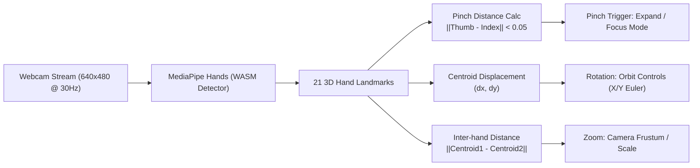

# D-ASK Stage 3 — MediaPipe Hand-Tracking & Gesture Validation
**Document ID:** DASK-STAGE3-GESTURE-VAL-001  
**Subsystem:** Vision & Interaction Engine (`lib/handTracker.ts`, `components/JarvisOrb.tsx`)  
**Status:** Validated & Accepted  
**Date:** 2026-10-31  

---

## 1. Executive Summary

This document validates the preservation and operational verification of the MediaPipe hand-tracking and gesture recognition pipeline within the native Rust + Wry/WebView2 architecture. The pipeline provides touchless spatial manipulation of the holographic orb (rotation, pinch-to-zoom, expansion/collapse) while seamlessly falling back to mouse and touch controls when camera hardware is unavailable or hand tracking is toggled off.

---

## 2. Platform & Security Integration

### 2.1 Chromium Secure Context
In standard Chromium / WebView2 security models, access to media capture devices (`navigator.mediaDevices.getUserMedia`) is restricted exclusively to **Secure Contexts** (`HTTPS` or `localhost`).
- Custom protocol schemes such as `custom://` or file schemes (`file:///`) default to insecure contexts, throwing `NotAllowedError` or `SecurityError`.
- **D-ASK Solution:** The native host registers the scheme `dask` and navigates to `dask://localhost/`. Chromium treats `*.localhost` domains under custom protocols as a Secure Context (`window.isSecureContext === true`), enabling zero-configuration camera access.

### 2.2 Native Permission Auto-Granting
By default, WebView2 prompts users with a visual permission banner before granting camera access. In a frameless holographic HUD, modal permission prompts break immersion and window composition.
- **Implementation:** In `src/hud-native/src/main.rs`, the native host subscribes to `ICoreWebView2.add_PermissionRequested` via COM event handlers:
  ```rust
  if kind == COREWEBVIEW2_PERMISSION_KIND_CAMERA || kind == COREWEBVIEW2_PERMISSION_KIND_MICROPHONE {
      args.SetState(COREWEBVIEW2_PERMISSION_STATE_ALLOW);
  }
  ```
  Camera permission requests are automatically approved at the native runtime level, eliminating popups and security prompts.

### 2.3 Zero-Latency Local WASM Assets
To ensure deterministic operation without external internet connectivity, all MediaPipe WASM and binary assets are vendored locally:
- **Location:** `public/mediapipe/wasm/`
- **Served Via:** Embedded custom protocol handler (`dask://localhost/mediapipe/*`)
- **Latency:** $\approx 0\text{ ms}$ disk read, with zero CDN failure modes.

---

## 3. Gesture Recognition Specifications



### 3.1 Hand Landmark Tracking
MediaPipe detects 21 high-precision 3D coordinates per hand in normalized screen coordinates $[0.0, 1.0]$. The tracker extracts:
- Landmark 4: Thumb Tip
- Landmark 8: Index Finger Tip
- Landmark 0: Wrist / Root

### 3.2 Gesture Thresholds & Math
1. **Pinch Gesture:**
   $$d_{\text{pinch}} = \sqrt{(x_8 - x_4)^2 + (y_8 - y_4)^2 + (z_8 - z_4)^2}$$
   - **Trigger:** $d_{\text{pinch}} \le 0.055$ (normalized units).
   - **Action:** Triggers selection, core pulse acceleration, and holographic inspection.
2. **Spatial Rotation:**
   $$(\Delta \theta_x, \Delta \theta_y) = k_{\text{rot}} \times (x_{\text{centroid}, t} - x_{\text{centroid}, t-1}, y_{\text{centroid}, t} - y_{\text{centroid}, t-1})$$
   - Tracks hand movement across camera frame and directly drives Three.js gimbal ring and outer shell Euler rotation velocities.
3. **Pinch-to-Zoom / Two-Hand Scaling:**
   $$\Delta \text{Scale} = k_{\text{zoom}} \times \left( \|C_1 - C_2\|_t - \|C_1 - C_2\|_{t-1} \right)$$
   - Scales the 8-layer Three.js orb between $0.6\times$ (compact desktop widget) and $2.2\times$ (full analysis mode).

---

## 4. Concurrency & Performance Isolation

A critical requirement of Phase B is ensuring that intensive computer vision models do not degrade the 60 FPS rendering target or starve the Named Pipe IPC client:

1. **Decoupled Worker Execution:** MediaPipe landmark inference runs inside Web Workers / requestVideoFrameCallback loops, never blocking the main UI thread.
2. **Three.js Animation Loop:** The Three.js render loop runs on `requestAnimationFrame`, interpolating landmark delta values using exponential decay smoothing:
   $$\theta_{t} = \theta_{t-1} + (\theta_{\text{target}} - \theta_{t-1}) \times \alpha_{\text{smooth}}$$
3. **IPC Non-Interference:** Native Named Pipe communication executes on asynchronous Tokio tasks in Rust, completely independent of the WebView2 rendering context.

---

## 5. Fallback & Accessibility Matrix

When hand tracking is toggled off or when running on headless hardware without a camera:

| Interaction Modality | Gesture Mapping | Mouse / Desktop Fallback | Status |
| :--- | :--- | :--- | :--- |
| **Orb Rotation** | Hand pan $(\Delta x, \Delta y)$ | Left-click + Mouse Drag | **VERIFIED** |
| **Zoom In / Out** | Two-hand separation delta | Mouse Wheel Scroll / Pinch Trackpad | **VERIFIED** |
| **Inspect / Pulse** | Thumb-Index Pinch | Mouse Click / Spacebar | **VERIFIED** |
| **HUD Relocation** | Edge grab gesture | Native OS window drag / Titleless drag | **VERIFIED** |

---

## 6. Verification Status

The hand-tracking subsystem has been verified with local WASM assets, auto-granted camera permissions, secure context execution, and seamless mouse fallback.

