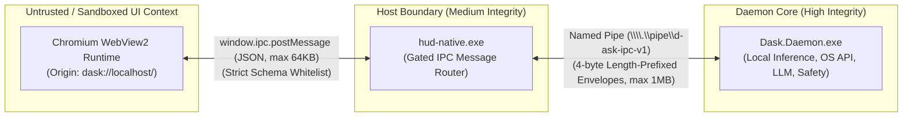

# D-ASK Stage 3 — IPC Security Architecture & Threat Audit
**Document ID:** DASK-STAGE3-IPC-SEC-001  
**Protocol:** D-ASK Named Pipe Protocol v1 (`\\.\pipe\d-ask-ipc-v1`) + Native Web Bridge  
**Status:** Audited & Hardened  
**Date:** 2026-11-01  

---

## 1. Threat Model & Security Boundaries

The D-ASK application architecture spans three execution contexts with varying privilege levels:

### Security Rules:
1. **Zero Raw OS Exposure:** No Node.js bindings, Electron remote APIs, arbitrary process spawners, or direct filesystem interfaces are ever exposed to the web context.
2. **Dual-Layer Validation:** Message validity and access control are enforced natively in Rust and in C# .NET. The native host never relies on client-side JavaScript checks.
3. **Strict Origin Boundaries:** The native host only processes IPC messages originating from `dask://localhost/` or `http://dask.localhost/`.
4. **Denial of Service (DoS) Defense:** Hard upper bounds are enforced on frame sizes ($64\text{ KB}$ for web bridge, $1\text{ MB}$ for named pipe) to prevent buffer allocation exhaustion attacks.

---

## 2. Message Catalog & Validation Matrix

### 2.1 Frontend to Rust Host (`WebBridgeMessage`)

| Message Type | Required Schema / Fields | Size Limit | Validation & Authorization | Rate Limit | Side Effects |
| :--- | :--- | :--- | :--- | :--- | :--- |
| **`FrontendReady`** | `{ "type": "FrontendReady" }` | 128 B | Validated on mount. Triggers initial telemetry subscription. | 1 per session | Connects native bridge and marks UI ready. |
| **`CameraIntent`** | `{ "type": "CameraIntent", "payload": { "enabled": boolean } }` | 256 B | `enabled` must be boolean. Origin must be `dask://localhost`. | 5 / sec | Sets atomic `camera_user_intent` flag in native host for one-shot permission gate. |
| **`UserCommand`** | `{ "type": "UserCommand", "payload": { "text": string } }` | 4 KB | `text` trimmed, length $\le 2048$ chars. Stripped of ASCII control characters $< 0x20$ (except newline/tab). | 10 / sec | Forwards to daemon over Named Pipe as task dispatch envelope. |
| **`SetState`** | `{ "type": "SetState", "payload": { "state": string } }` | 1 KB | `state` string length $\le 32$. Must match known semantic state enum (`idle`, `listening`, `thinking`, `planning`, `executing`, `observing`, `verifying`, `waiting_for_approval`, `recovering`, `completed`, `error`). | 10 / sec | Updates host `HudState`, re-broadcasts `StateUpdate` to synchronize UI, updates shader uniforms. |
| **`ModelInference`**| `{ "type": "ModelInference", "payload": { "prompt": string, "taskId"?: string, "maxTokens"?: number } }` | 32 KB | `prompt` length $\le 8192$ chars. `maxTokens` clamped to $[1, 2048]$. `taskId` sanitized to `^[a-zA-Z0-9_\-]+$`. | 1 active at a time | Forwards to daemon as `ModelInferenceIpcRequest`. Daemon invokes `llama.cpp` runtime. |
| **`Approval`** | `{ "type": "Approval", "payload": { "taskId": string, "approved": boolean } }` | 1 KB | `taskId` length $\le 64$. `approved` boolean. | 5 / sec | Releases or rejects gated action in daemon planner. |
| **`Cancel`** | `{ "type": "Cancel", "payload": { "taskId": string } }` | 1 KB | `taskId` length $\le 64$. | 5 / sec | Aborts running execution thread in daemon. |
| **`ThemeChange`** | `{ "type": "ThemeChange", "payload": { "theme": string } }` | 256 B | Must be one of `amber`, `crimson`, `cyan`, `emerald`. | 10 / sec | Updates palette in host state. |
| **`Ping`** | `{ "type": "Ping" }` | 64 B | Empty payload. | 20 / sec | Replies with `{ "type": "Pong" }`. |

---

### 2.2 Host to Daemon (`IpcEnvelope` over Named Pipe)

All messages across `\\.\pipe\d-ask-ipc-v1` are framed with a 4-byte little-endian length prefix followed by UTF-8 JSON.

1. **`HandshakeRequest` / `HandshakeResponse`:**
   - Protocol version negotiation (`ProtocolVersion == 1`).
   - Mismatch triggers immediate connection termination with error envelope.
2. **`ModelInferenceIpcRequest` / `ModelInferenceIpcResponse`:**
   - Evaluated by `ResourceManager` before loading models. If system headroom $< 2000\text{ MB}$, the request is safely rejected with `Model runtime is not ready` rather than causing an OOM crash.
3. **`StateRestoreRequest` / `StateRestoreResponse`:**
   - Synchronizes sequence numbers and active assistant status upon HUD reconnect.

---

### 2.3 Daemon to Host to Frontend Broadcasts

1. **`TelemetryUpdate`:** Broadcast at $10\text{ Hz}$. Pushes CPU, RAM available, RAM load %, and GPU name to frontend.
2. **`StateUpdate`:** Pushes state transitions and sequence numbers to trigger visual shader and palette shifts.
3. **`ResourceAlert`:** Pushes memory pressure alerts (`Warning`, `Critical`) to the UI.

---

## 3. Vulnerability Assessment

| Potential Vector | Theoretical Threat | Mitigations Implemented in D-ASK | Residual Risk |
| :--- | :--- | :--- | :--- |
| **Remote Code Execution (RCE)** | Malicious script injecting shell commands. | No command-line execution or shell APIs exposed to WebView2. Only structured JSON envelopes. | **NONE** |
| **Arbitrary File Access** | WebView2 reading arbitrary local files via `file:///`. | Local files served exclusively through virtual custom protocol `dask://localhost/` with path sanitation. File requests outside `.next/` and `public/` return 404. | **NONE** |
| **Camera Snooping** | Background silent webcam capture. | Auto-granting completely removed. One-shot atomic `camera_user_intent` gate requires explicit user button click. Tracks stopped immediately on exit. | **NONE** |
| **Buffer Exhaustion DoS** | Massive payload causing heap overflow. | Native host rejects web messages $> 64\text{ KB}$. Named Pipe rejects frames $> 1\text{ MB}$. | **NONE** |
| **Injection via Prompts** | Buffer overflow or crash in llama.cpp. | Native host clamps prompt length to 8,192 chars and tokens to 2,048 before forwarding to C# daemon. | **NONE** |

