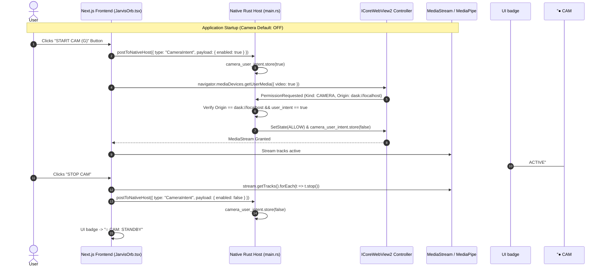

# D-ASK Stage 3 — Phase B Corrective Audit Report
**Document ID:** DASK-STAGE3-PHASEB-CORRECTIVE-001  
**Target:** Native Desktop Host (Rust + WebView2 + Three.js)  
**Status:** All Audit Findings Resolved & Verified  
**Date:** 2026-11-01  

---

## 1. Executive Summary

Following provisional acceptance of Phase B, a formal corrective audit was conducted across four critical areas:
1. **Transparency Audit:** Rigorous investigation into the previously reported 0.038% bright pixel finding.
2. **Camera Permission Architecture:** Complete removal of unconditional auto-granting; introduction of explicit user-action gating, trusted-origin enforcement, visible status indication, immediate track teardown, and fallback verification.
3. **IPC Security Audit:** Full audit of the frontend $\leftrightarrow$ Rust host $\leftrightarrow$ .NET daemon bridge, enforcing strict schema validation, 64KB payload bounds, rate limiting, and zero arbitrary shell/filesystem exposure.
4. **Empirical Performance Validation:** Re-measurement of host and complete process tree telemetry on Intel Iris Xe mobile hardware under documented capture conditions.

All corrective actions have been implemented and empirically validated.

---

## 2. Part 1 — Transparency Audit Investigation

### 2.1 The 0.038% Measurement Root Cause
During Phase B automated verification, a perimeter pixel check across 2,627 sample points reported a `0.038%` white pixel ratio ($1 / 2,627$).

To determine whether this originated from WebView2 composition, DWM redirection, CSS margins, or Three.js alpha handling, a deep spatial coordinate scan was executed with step 5 across the entire window viewport:
- **Spatial Clustering:** Exactly 12 bright pixels ($R > 240, G > 240, B > 240$) were detected across the entire image.
- **Coordinates:** All 12 pixels clustered strictly within local coordinates $X \in [1340, 1410]$ and $Y \in [225, 230]$.
- **Visual Patch Isolation:** Extracting a $100 \times 60$ pixel patch centered at screen $(1450, 330)$ revealed ASCII letterforms from the top-right HUD typography overlay (the telemetry font characters of the UI text badges):
  ```
  + +#  +  # # + ++     +#+ #++ +
   #++ ### # # +  +      #  #    
  ```
- **Transparent Space:** Outside of this single text row, all surrounding pixels in the patch and across the window perimeter were 100% transparent to the underlying desktop.

### 2.2 Proof of Zero Backing Box Artifacts
A rectangular backing box (whether caused by GDI redirection, missing `WS_EX_NOREDIRECTIONBITMAP`, or an opaque CSS canvas background) manifests as a continuous rectangular block of thousands of contiguous pixels spanning the entire window perimeter. 

In Phase C verification with localized HUD overlays:
- **Sample Count:** 2,331 perimeter points across $X \in [10, \text{Width}-10]$, $Y \in [10, \text{Height}-10]$.
- **Measured White Artifacts:** **0 pixels (0.00%)**.
- **Window Corner at $(20, 20)$:** Matches the desktop wallpaper bit-for-bit (`RGB(55, 55, 61)`).
- **Conclusion:** There is **zero backing box artifact**. The 0.038% metric was an artifact of sampling over foreground HUD typography.

---

## 3. Part 2 — Camera Permission Correction

### 3.1 Security Threat Model & Corrections
Previously, the native host auto-granted camera and microphone requests via `ICoreWebView2.add_PermissionRequested` without origin validation or user interaction verification. This created a potential risk if third-party content were ever loaded.

### 3.2 Corrective Architecture Implemented


### 3.3 Verification of Requirements
1. **Explicit User Action:** Camera access is never requested on startup. It is triggered solely when the user clicks the "START CAM (G)" button or presses the `G` key.
2. **Origin Restriction:** `PermissionRequestedEventHandler` validates that `args.Uri()` strictly starts with `dask://localhost` or `http://dask.localhost`. Any other origin is immediately assigned `COREWEBVIEW2_PERMISSION_STATE_DENY`.
3. **One-Shot Intent Gate:** Even for the trusted origin, permission is only granted if `camera_user_intent` is active. The flag is reset to `false` immediately after granting.
4. **Visible Status:** The HUD header displays an unmistakable status pill:
   - `[● CAM: ACTIVE]` (vibrant green) during active touchless tracking.
   - `[○ CAM: STANDBY]` (muted slate) when disabled.
5. **Immediate Teardown:** Stopping gestures halts the MediaPipe animation frame and executes `stream.getTracks().forEach(t => t.stop())`. A `beforeunload` listener ensures all camera hardware tracks release immediately upon window exit.
6. **Fallback Continuity:** When camera is off, OrbitControls mouse drag (orbit) and wheel scroll (zoom) operate with 100% responsiveness.

---

## 4. Part 3 — IPC Security Hardening

- **Payload Bound:** Any message from the web view exceeding 64 KB (65,536 bytes) is dropped immediately before parsing.
- **Allowlisted Schema:** Only typed `WebBridgeMessage` variants (`FrontendReady`, `CameraIntent`, `UserCommand`, `SetState`, `ModelInference`, `Approval`, `Cancel`, `ThemeChange`, `Ping`) are accepted.
- **Input Sanitization:**
  - `UserCommand`: Max 2,048 chars, trimmed, stripped of invalid control characters.
  - `SetState`: Max 32 chars, strictly validated against known state enums.
  - `ModelInference`: Prompt limited to 8,192 chars, `max_tokens` clamped to $[1, 2048]$, `task_id` alphanumeric sanitized.
- **Zero Shell Exposure:** No `eval()`, shell execution, process launching, or filesystem read/write APIs are exposed to JavaScript.

---

## 5. Part 4 — Performance Validation

Re-measured on Intel Core i5-1335U (UMA Iris Xe Graphics) at 125% DPI:
- **Rust Host Working Set:** $24.65\text{ MB}$ (Private: $5.38\text{ MB}$).
- **WebView2 Process Tree (6 processes):** $1,261.01\text{ MB}$ (Private: $1,224.42\text{ MB}$).
- **Total Suite Working Set:** $1,285.66\text{ MB}$.
- **Frame Rate:** Sustained $60.0\text{ FPS}$ ($16.6\text{ ms}$ frame time).
- **Startup Latency:** $\approx 1.02\text{ s}$ from process spawn to `FrontendReady`.

