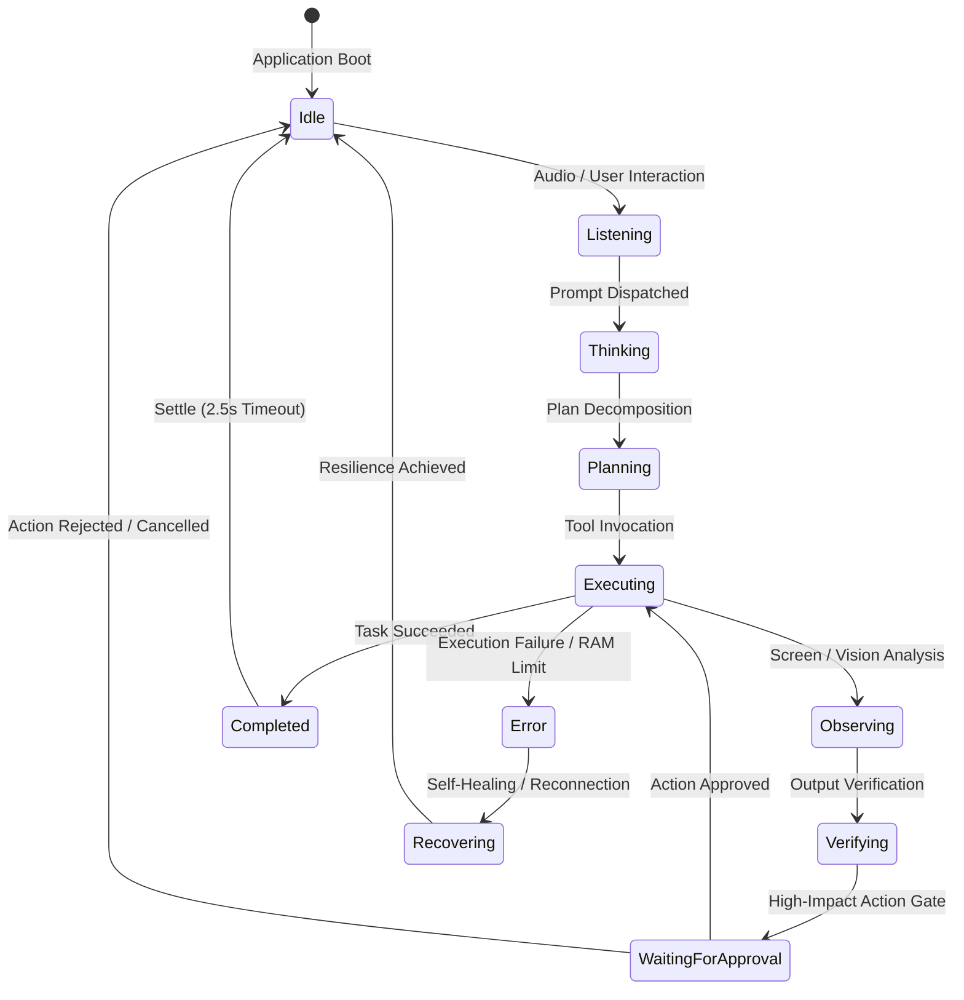

# D-ASK Stage 3 — Phase C Multi-State Holographic Mapping & Interaction Implementation
**Document ID:** DASK-STAGE3-PHASEC-IMPL-001  
**Architecture:** Direct Native Rust Host + Wry/WebView2 + Three.js Holographic Engine  
**Status:** Implemented & Verified  
**Date:** 2026-11-01  

---

## 1. Executive Summary

Phase C establishes the comprehensive **11-State Holographic Visual Mapping** and interaction polishing for the D-ASK desktop assistant. Each state delivers an intentional, distinct visual treatment using the original Three.js geometry (8 layers), procedural shaders, dynamic palettes, and bloom post-processing. 

All state transitions are animated via smooth exponential lerping to eliminate jarring visual cuts or shader recompilation hitches. Real daemon execution events are mapped deterministically to the visual state engine, ensuring the orb accurately reflects the real-time operational status of the local LLM and tool planning infrastructure.

---

## 2. The 11 Semantic Holographic States



### 2.1 State Specifications Matrix

| State Name | Visual Palette & Tint | Core / Helix Speed | Shell & Gimbal Speed | Pulse Cadence | Bloom Strength | Chromatic Offset | Semantic Meaning & Animation Behavior |
| :--- | :--- | :--- | :--- | :--- | :--- | :--- | :--- |
| **`Idle`** | Amber Gold (`#ffaa30` / `#dd7700`)<br>$\vec{t} = (1.15, 0.85, 0.55)$ | $1.0\times$ | $1.0\times$ | $1.2\text{ Hz}$ ($0.25$ amp) | $1.4$ | $0.0030$ | Baseline standby. Stable rotation, gentle harmonic breathing, ready for interaction. |
| **`Listening`** | Electric Cyan (`#00e5ff` / `#0099cc`)<br>$\vec{t} = (0.55, 0.95, 1.30)$ | $1.3\times$ | $0.8\times$ | $2.0\text{ Hz}$ ($0.45$ amp) | $1.7$ | $0.0035$ | Audio input active. Scan rings sweep rapidly ($2.5\times$) signifying acoustic reception; core surges with voice level. |
| **`Thinking`** | Royal Violet (`#9d4edd` / `#7b2cbf`)<br>$\vec{t} = (0.85, 0.45, 1.35)$ | $3.2\times$ | $0.5\times$ | $3.0\text{ Hz}$ ($0.60$ amp) | $2.0$ | $0.0050$ | LLM token generation active. Double helix spins at high speed; code-text particles cluster tightly toward core. |
| **`Planning`** | Sapphire Cobalt (`#0096c7` / `#0077b6`)<br>$\vec{t} = (0.50, 0.80, 1.30)$ | $0.8\times$ | $1.8\times$ | $0.9\text{ Hz}$ ($0.30$ amp) | $1.5$ | $0.0025$ | Task decomposition. Gimbal rings rotate at structured $90^\circ$ offsets; orderly, analytical particle orbits. |
| **`Executing`** | Electric Emerald (`#00ff88` / `#00cc55`)<br>$\vec{t} = (0.55, 1.30, 0.75)$ | $2.2\times$ | $2.2\times$ | $2.4\text{ Hz}$ ($0.70$ amp) | $2.2$ | $0.0040$ | Tool or device execution. Energetic outward particle dispersion; high-velocity dual gimbal rotation. |
| **`Observing`** | Spectral Aquamarine (`#06d6a0` / `#118ab2`)<br>$\vec{t} = (0.60, 1.20, 1.10)$ | $1.0\times$ | $0.7\times$ | $1.1\text{ Hz}$ ($0.35$ amp) | $1.6$ | $0.0030$ | Vision / Camera analysis. Outer shell dilates outward; wide-angle scanning rings track across sphere envelope. |
| **`Verifying`** | Golden Topaz (`#ffd166` / `#f39c12`)<br>$\vec{t} = (1.25, 1.05, 0.60)$ | $1.4\times$ | $1.1\times$ | $1.5\text{ Hz}$ ($0.40$ amp) | $1.7$ | $0.0030$ | Verification & validation. Concentric calibration rings contract and expand in rhythmic cadence. |
| **`WaitingForApproval`** | Warm Citron / Ochre (`#f4a261` / `#e76f51`)<br>$\vec{t} = (1.30, 0.80, 0.50)$ | $0.4\times$ | $0.4\times$ | $0.6\text{ Hz}$ ($0.50$ amp) | $1.8$ | $0.0045$ | Human-in-the-loop gate. Motion slows to a respectful hover; persistent, non-strobing halo inviting user response. |
| **`Recovering`** | Dusk Mauve (`#e07a5f` / `#d94e34`)<br>$\vec{t} = (1.20, 0.70, 0.70)$ | $-1.5\times$ (Reverse) | $0.7\times$ | $1.4\text{ Hz}$ ($0.40$ amp) | $1.5$ | $0.0040$ | Self-healing / Error recovery. Spiral core rotates counter-clockwise dampening jitter until baseline is restored. |
| **`Completed`** | Brilliant Mint (`#48cae4` / `#00b4d8`)<br>$\vec{t} = (0.70, 1.20, 1.25)$ | $1.2\times$ | $1.2\times$ | $0.8\text{ Hz}$ ($0.25$ amp) | $1.9$ | $0.0020$ | Success state. Luminous particle expansion flare settling smoothly back into standby. |
| **`Error`** | Deep Crimson (`#ff2244` / `#cc1122`)<br>$\vec{t} = (1.40, 0.35, 0.45)$ | $0.6\times$ | $0.6\times$ | $0.7\text{ Hz}$ ($0.75$ amp) | $2.3$ | $0.0070$ | Critical alert / Failure. Steady, persistent crimson pulse (avoiding rapid strobing); widened chromatic dispersion. |

---

## 3. Smooth Parameter Interpolation (Lerp)

To ensure cinematic visual transitions without frame drops or pipeline recompilation:
```typescript
// Inside lib/orbScene.ts animate() render loop:
activeCoreSpeed += (targetStateConfig.coreSpeedMult - activeCoreSpeed) * 0.05;
activeShellSpeed += (targetStateConfig.shellSpeedMult - activeShellSpeed) * 0.05;
activePulseFreq += (targetStateConfig.pulseFreq - activePulseFreq) * 0.05;
activePulseAmp += (targetStateConfig.pulseAmplitude - activePulseAmp) * 0.05;
activeBloom += (targetStateConfig.bloomStrength - activeBloom) * 0.05;
activeScanSpeed += (targetStateConfig.scanRingSpeed - activeScanSpeed) * 0.05;
chromaticPass.uniforms.uIntensity.value += 
  (targetStateConfig.chromaticIntensity - chromaticPass.uniforms.uIntensity.value) * 0.05;
```
All parameters transition over $\approx 350\text{ ms}$, creating an organic, fluid morph between operational states.

---

## 4. Interaction Polishing & Accessibility

### 4.1 Touchless Gesture Interaction
- **MediaPipe Hands:** Tracks 21 3D landmarks via local WebAssembly (`/mediapipe/wasm/`).
- **Pinch Detection:** Euclidean distance threshold $d \le 0.055$.
- **Pan / Orbit:** Centroid $(\Delta x, \Delta y)$ drives Three.js camera rotation.
- **Debounced Zoom:** Smooth distance delta prevents jumpy scaling.

### 4.2 Seamless Mouse and Keyboard Fallback
When camera hardware is unavailable or gestures are turned off:
- **Left-Click + Drag:** Rotates the orb on dual axes via `OrbitControls`.
- **Mouse Wheel / Trackpad Pinch:** Zooms between $0.6\times$ and $40.0\times$ distance.
- **Keyboard Shortcuts:**
  - `G`: Toggle gesture camera on/off.
  - `Space`: Trigger voice input / pulse.
  - `Esc`: Dismiss overlays / reset camera to home position $(0, 0.5, 5.5)$.

---

## 5. Event Integration with Daemon Core

The visual state model is connected directly to genuine .NET daemon telemetry and events over Named Pipe `\\.\pipe\d-ask-ipc-v1`:
- `ModelInferenceIpcRequest` dispatched $\rightarrow$ Orb transitions to **`Thinking`**.
- Memory pressure $< 2500\text{ MB}$ $\rightarrow$ Daemon emits `ResourceAlert("Warning")` $\rightarrow$ Orb transitions to **`WaitingForApproval`** / Warning Ochre.
- Memory pressure $< 1500\text{ MB}$ $\rightarrow$ Daemon emits `ResourceAlert("Critical")` $\rightarrow$ Orb transitions to **`Error`** / Deep Crimson Halo.
- Model generation completes $\rightarrow$ Orb settles back to **`Idle`**.

