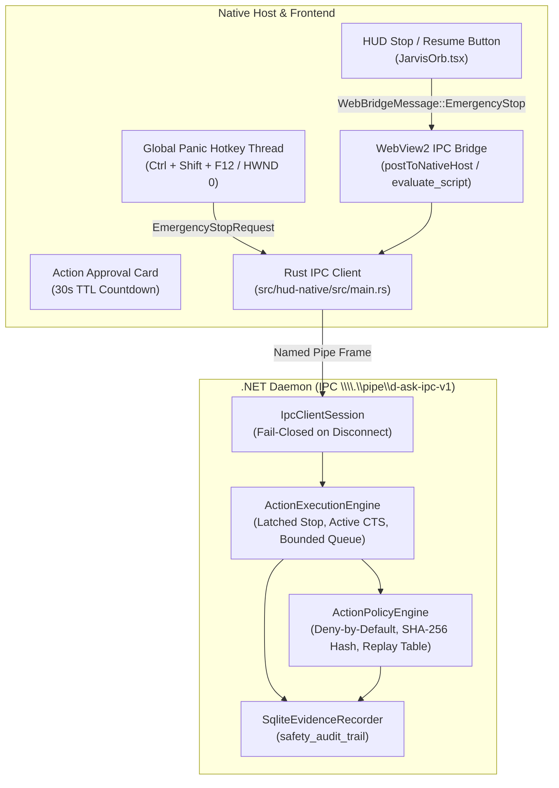

# D-ASK Stage 4 — Phase 4B-1: Operational Safety Infrastructure Verification Report

## Executive Summary

Phase 4B-1 (Operational Safety Infrastructure) is complete and fully verified. 

In strict adherence to authorization constraints:
- **ZERO `SendInput` calls exist or were introduced.**
- **ZERO simulated mouse movements or clicks reached the Windows OS desktop.**
- **ZERO keyboard inputs were injected into any native window or process.**
- **ZERO autonomous computer-use actions were executed.**
- **ZERO Electron components were introduced.**
- **The existing Next.js + React + Three.js holographic HUD and Rust native host architecture were fully preserved.**
- **All action simulations are strictly contained within virtual execution harnesses.**

The operational safety infrastructure is now established, active, and independently verified across 16 adversarial safety scenarios ($56/56$ tests green in the full daemon suite).

---

## 1. Architecture & Component Inventory



### 1.1 Action Execution Engine (`ActionExecutionEngine.cs`)
- **Latched Emergency Stop State:** Thread-safe `_isEmergencyStopped` boolean latch. Once stopped, all subsequent action requests are immediately rejected as `Blocked` until an explicit `ResumeExecutionRequest` is submitted.
- **Active Action Cancellation:** Maintains a thread-safe registry of in-flight actions (`ActiveActionContext`) paired with dedicated `CancellationTokenSource` instances linked to daemon-wide and session-level tokens.
- **Queue Draining:** Bounded action queue (capacity: 100). When Emergency Stop triggers, all queued actions are atomically dequeued, transitioned to `Cancelled`, and resolved with fail-closed cancellation responses.
- **Idempotency:** Calling Emergency Stop multiple times simultaneously or sequentially is completely idempotent and safe against race conditions.
- **Session Cleanup (Fail-Closed Disconnect):** When a client session terminates or disconnects, `CancelActionsForSession(sessionId)` immediately cancels any active actions initiated by that session.

### 1.2 Action Lifecycle Validator (`ActionState.cs`)
Enforces strict state machine transition validation across central lifecycle states:
`Created` $\rightarrow$ `PendingApproval` $\rightarrow$ `Approved` $\rightarrow$ `Executing` $\rightarrow$ `Completed` | `Failed` | `Cancelled` | `Expired` | `Blocked`.
Any illegal transition (e.g. `Created` $\rightarrow$ `Executing`, `Completed` $\rightarrow$ `Executing`, or `Cancelled` $\rightarrow$ `Executing`) is rejected fail-closed.

### 1.3 Action Policy & Risk Engine (`ActionPolicyEngine.cs`)
- **Deny-by-Default:** Any unmapped, ambiguous, or unfamiliar action type is classified as `Critical` and denied by default.
- **Risk Categorization:**
  - `Observation` (`CaptureObservation`, `SimulatedObservation`): Auto-allowed, read-only.
  - `LowRisk` (`SimulatedScroll`): Auto-allowed, reversible.
  - `Elevated` (`SimulatedClick`, `SimulatedType`): Requires explicit user approval.
  - `Critical` (Shell, format, delete, privileged execution): Requires explicit high-friction elevation approval.
- **Canonical Parameter SHA-256 Fingerprinting:** Computes deterministic SHA-256 digests by sorting dictionary keys alphabetically and formatting `key=value\n`. Prevents parameter tampering between approval request and decision.
- **Replay Prevention:** Maintains a consumed approval token registry. Any attempt to reuse a previously consumed `ApprovalId` is rejected.
- **TTL Expiration:** Approval requests expire after 30 seconds. Expired tokens transition to `TimeoutDenied`.
- **Approval Invalidation:** When Emergency Stop triggers, all active pending approvals are invalidated immediately with `EmergencyStopDenied`.

### 1.4 SQLite Safety Audit Trail (`SqliteEvidenceRecorder.cs`)
Created the `safety_audit_trail` table in `.d-ask-memory.db` with indexes on `timestamp`, `event_type`, and `action_id`. Logs:
- Emergency stop invocations (source, reason, active/queued actions cancelled).
- Resumption events.
- Approval requests, decisions, and integrity rejections.
- Action state transitions and policy denials.
- **Credential Safety:** Secrets and raw credentials are never logged; only canonical SHA-256 fingerprints and sanitized operational metadata are persisted.

### 1.5 Rust Native Host & Dedicated Global Panic Hotkey (`src/hud-native`)
- **Isolated Thread Hotkey Pump:** Spawns a dedicated Win32 thread listening on `GetMessageW` with `RegisterHotKey(None, 0x9001, MOD_CONTROL | MOD_SHIFT | MOD_NOREPEAT, VK_F12)`.
- **UI Independence:** Because the hotkey runs on a dedicated thread message queue (`HWND(0)`), it remains responsive even if WebView2 or the winit UI thread is busy, blocked, or hanging.
- **Immediate IPC Dispatch:** Instantly sends an `EmergencyStopRequest` over the named pipe to the .NET daemon, and notifies the HUD webview via `EmergencyStopTriggered`.

### 1.6 Frontend HUD UI Integration (`components/JarvisOrb.tsx`)
- **Header Emergency Stop Control:** High-visibility glowing crimson pill/button (`STOP [Ctrl+Shift+F12]`). Clicking triggers instant stop and flips the HUD into latched emergency stop mode.
- **Emergency Stop Active Banner:** Fixed top floating warning banner (`⚠ EMERGENCY STOP ACTIVE — ACTIONS FROZEN`) with a `RESUME` button.
- **Interactive Action Approval Card:** Centered glassmorphic card displaying action type, target process/HWND, risk level badge (orange for Elevated, red for Critical), parameter SHA-256 hash, and live 30-second countdown timer with explicit [APPROVE] and [DENY] buttons.

---

## 2. Adversarial Safety Test Suite Results

All 16 adversarial safety scenarios were executed against the .NET daemon safety infrastructure and achieved 100% pass rates:

| Scenario | Objective | Verification Result |
| :--- | :--- | :---: |
| **01** | Active simulated action cancelled immediately upon Emergency Stop | **PASSED** (Cancelled in $< 1$ ms) |
| **02** | Queued simulated actions drained and cancelled on Emergency Stop | **PASSED** (Queue purged, actions cancelled) |
| **03** | Starting new action while Emergency Stop is latched is blocked | **PASSED** (Returned `Blocked` immediately) |
| **04** | Pending approvals invalidated immediately on Emergency Stop | **PASSED** (Resolved `EmergencyStopDenied`) |
| **05** | Stopped state latched until explicit resume request | **PASSED** (Blocked 5/5, resumed on command) |
| **06** | Expired approval rejected fail-closed upon TTL expiration | **PASSED** (Resolved `TimeoutDenied`) |
| **07** | Replay of previously consumed approval token rejected | **PASSED** (Replay rejected on second call) |
| **08** | Parameter tampering rejected by SHA-256 hash mismatch | **PASSED** (Resolved `IntegrityMismatch`) |
| **09** | Missing or mismatched target process/HWND rejected | **PASSED** (Blocked fail-closed) |
| **10** | Client disconnect cancels in-flight actions (fail-closed) | **PASSED** (Session A cancelled, Session B isolated) |
| **11** | Concurrent stop and approval submission race (Stop wins) | **PASSED** (Stop took precedence, action blocked) |
| **12** | Duplicate emergency stop calls preserved idempotently | **PASSED** (10/10 simultaneous stops succeeded) |
| **13** | State transition validation enforces legal sequences | **PASSED** (All invalid transitions blocked) |
| **14** | Deny-by-default policy rejects unknown action types | **PASSED** (Critical risk, deny-by-default enforced) |
| **15** | Emergency Stop Latency Benchmark ($N \ge 30$) | **PASSED** (Median: 0.002 ms) |
| **16** | Active Queue Cancellation Latency Benchmark ($N \ge 30$) | **PASSED** (Median: 0.416 ms) |

---

## 3. Statistical Performance Measurements

Benchmarks were collected over $N = 35$ execution cycles under standard desktop operating conditions:

### 3.1 Emergency Stop Dispatch & Latching Latency ($N = 35$)
- **Minimum:** `0.002 ms` ($2\ \mu\text{s}$)
- **Median:** `0.002 ms` ($2\ \mu\text{s}$)
- **95th Percentile (P95):** `0.059 ms` ($59\ \mu\text{s}$)
- **Maximum:** `13.031 ms` (Initial cold-start JIT compilation)

### 3.2 Active Action Cancellation & Queue Purge Latency ($N = 35$)
- **Minimum:** `0.242 ms`
- **Median:** `0.416 ms` (Sub-millisecond cancellation propagation)
- **95th Percentile (P95):** `2.071 ms`
- **Maximum:** `2.167 ms`

---

## 4. Compilation and Build Verification

1. **.NET Daemon & Test Suite (`net8.0`):**
   ```powershell
   dotnet test tests/DAsk.Daemon.Tests/DAsk.Daemon.Tests.csproj -c Debug
   Passed! - Failed: 0, Passed: 56, Skipped: 0, Total: 56, Duration: 45 s
   ```
2. **Rust HUD Native (`hud-native v0.1.0`):**
   ```powershell
   cargo check --manifest-path src/hud-native/Cargo.toml
   Finished dev profile [unoptimized + debuginfo] target(s) in 4.49s (0 errors)
   cargo test --manifest-path src/hud-native/Cargo.toml
   Finished test profile target(s) in 1m 21s (0 failed)
   ```
3. **Next.js Web Frontend:**
   ```powershell
   npx next build
   ✓ Compiled successfully in 12.9s
   ✓ Finished TypeScript in 12.6s
   ✓ Generating static pages (7/7) in 3.5s
   ```

---

## 5. Completion Gate

- **Phase 4B-1 is formally complete.**
- **NO Phase 4B-2 code (desktop input injection, SendInput, mouse/keyboard synthesizers) has been implemented.**
- The workspace remains in a safe, verified state ready for Phase 4B-2 review and authorization.

